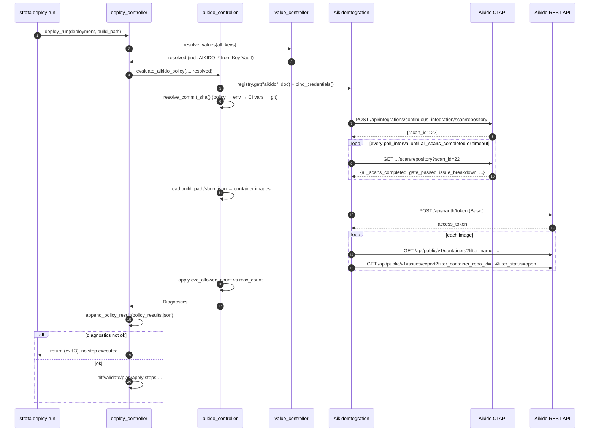

# Aikido Security - API reference

> **Archived 2026-10-28 (vendor reference).** Written 2026-10-26. This was the first, Aikido-only design. It is superseded by
> the vendor-neutral [security-gates.md](../design/security-gates.md), where Aikido is the
> first implementation of two capabilities (`release-gate`, `image-findings`).
>
> - **Sections 1-13 are superseded.** Kept for history and for the Aikido-specific reasoning they
>   carry (credentials D3, commit SHA D7, image naming D8, missing-data D10, deferrals D12). Where
>   they disagree with security-gates.md, that document wins.
> - **Appendices A-D are authoritative** and are what the new design points to: the offline Aikido
>   API reference (A), test fixtures (B), strata code anchors (C) and sources (D).
>   Items marked **[U]** are confirmed on first use against a real Aikido workspace; correct this
>   file and `integrations/aikido.py` then.

|                   |                                                                                                                                                                                                                                                                                                                                     |
| ----------------- | ----------------------------------------------------------------------------------------------------------------------------------------------------------------------------------------------------------------------------------------------------------------------------------------------------------------------------------- |
| **Status**        | Archived: sections 1-13 superseded, appendices are the vendor reference                                                                                                                                                                                                                                                             |
| **Author**        | Vincent Huybrechts                                                                                                                                                                                                                                                                                                                  |
| **Date**          | 2026-10-26                                                                                                                                                                                                                                                                                                                          |
| **Target**        | strata 2.x (after 2.0.0; designed against 2.0.0rc1)                                                                                                                                                                                                                                                                                 |
| **Work document** | [docs/archive/aikido-integration.md](aikido-integration.md)                                                                                                                                                                                                                                                                         |
| **Related**       | ADR-0003 (layering), ADR-0004 (exit codes), ADR-0021 (integration layer), ADR-0022 D4 (build renders, deploy resolves), docs/archive/cve-scanner-integration.md, docs/archive/checkov-integration.md, docs/design/audit-sink-dispatch.md (D4: credentials), docs/work/audit-trail.md (policy_results), docs/work/sbom-generation.md |

> **This document is self-contained on purpose.** It will be implemented where
> there is no internet access. Everything needed about the Aikido APIs is in
> [Appendix A](#appendix-a--aikido-api-reference-offline). Example payloads
> for tests are in [Appendix B](#appendix-b--test-fixtures), and the strata
> code this design builds on is listed in [Appendix C](#appendix-c--strata-code-anchors-200rc1).
> Every external fact is labelled **[V]** (verified against a primary source:
> Aikido's docs, or the source of Aikido's own MIT-licensed
> `@aikidosec/ci-api-client` 1.0.22) or **[U]** (unverified: confirm the first
> time the code talks to a real Aikido workspace, see [§13](#13-risks-and-open-questions)).

---

## 1. Summary

Add a built-in `aikido` integration that lets strata use findings from the
[Aikido Security](https://www.aikido.dev) platform as **deploy gates**:

1. **Release gate.** Before `deploy run` touches any provisioner, ask Aikido's
   CI API whether the solution's repository at the commit being deployed
   passes its release gate (new or open dependency/IaC/secrets/SAST/malware
   issues at or above a severity).
2. **Image gate.** For every container image in the `sbom.json` that
   `build run` already writes, look the image up in Aikido and count its open
   issues against a severity/count threshold, honouring the existing
   `cve_allowed` allowlist.

Both gates work the same way as the existing `cve_policy` and `checkov_policy`.
They are configured on the Workspace, use `enforcement: deny | warn` and
`on_missing_data: skip | warn | block`, report through `Diagnostics`, and are
recorded in `policy_results.json` so the audit manifest captures them. A small
`strata aikido` command group exposes the same checks outside a deploy, for CI
pipelines.

## 2. Context

### 2.1 Aikido in one paragraph

Aikido is a hosted application-security platform. It connects to a git
provider (GitHub, GitLab, Bitbucket, Azure DevOps) and to container
registries and clouds, then continuously runs SCA (open-source dependency
CVEs), SAST, IaC scanning, secrets detection, malware detection, licence and
EOL checks, and container image scanning. Findings are deduplicated into
**issues**, each with a severity (`critical | high | medium | low`), a status
(`open | ignored | snoozed | closed`) and an SLA. Aikido has two machine
interfaces that matter here:

- the **CI API**, authenticated with a CI token, which starts a scan of a
  repository at a commit and returns a pass/fail **gate** result;
- the **public REST API** (`/api/public/v1`), authenticated with OAuth2 client
  credentials, which lists repositories and containers and exports issues.

### 2.2 What strata v2 already has

| Capability                                                                                               | Where                                                                                                             | Relevance                                                               |
| -------------------------------------------------------------------------------------------------------- | ----------------------------------------------------------------------------------------------------------------- | ----------------------------------------------------------------------- |
| Integration layer: `Integration` base class, capability ABCs, lazy registry, `Integration` document kind | `integrations/base.py`, `integrations/capabilities.py`, `integrations/registry.py`, `models/integration_model.py` | `aikido` is a new registry entry with the `scanner` capability          |
| `ScannerIntegration` ABC (just `ensure_available()`)                                                     | `integrations/capabilities.py`                                                                                    | `AikidoIntegration` implements it                                       |
| CVE gate on the SBOM (Trivy/Grype)                                                                       | `controllers/sbom_controller.py::evaluate_cve_policy`, `models/sbom_model.py::CveMaxSeverityPolicyModel`          | Template for policy shape, allowlist and `on_missing_data` semantics    |
| Checkov gate on rendered IaC                                                                             | `controllers/checkov_controller.py`, `models/checkov_model.py`                                                    | Second template; shows a scanner with its own result model              |
| CycloneDX 1.6 SBOM at `build_path/sbom.json` (images, Helm charts, Terraform providers/modules)          | `controllers/sbom_controller.py::write_sbom`, `integrations/sbom_collectors/*`                                    | Input for the image gate                                                |
| Policy result sidecar `build_path/policy_results.json`, read by audit finalize                           | `controllers/policy_results.py`, `controllers/audit_run.py`                                                       | Where gate results are recorded                                         |
| Deploy resolves every value, secrets included, before any step                                           | `controllers/deploy_controller.py::deploy_run` (`resolve_values(...)`)                                            | Where Aikido credentials are resolved, for example from Azure Key Vault |
| HTTP transport: 4xx/5xx returned, not raised; no TLS-skip switch                                         | `utils/transport.py::http_request`, `HttpResult`                                                                  | All Aikido calls go through it                                          |
| Exit codes: diagnostics not ok means exit 3                                                              | `commands/run.py`, `commands/exit_codes.py`                                                                       | A gate breach exits 3, the same as a CVE/Checkov breach                 |

### 2.3 Gap

The CVE and Checkov gates scan **locally** with whatever is on `PATH`, so they
see only what strata renders and know nothing of the organisation's
triage (ignored/snoozed issues, SLAs, malware, secrets in history). Teams that
already run Aikido want the deploy to respect **Aikido's** verdict, which
already reflects their triage, without installing scanners on every runner.

## 3. Goals and non-goals

**Goals**

- G1. Gate `deploy run` (and `deploy plan|apply|setup|check`) on the Aikido release-gate verdict for the solution repository at the deployed commit.
- G2. Gate `deploy run` on open Aikido issues for the container images the deployment ships, read from `sbom.json`.
- G3. Configure it like the existing gates: workspace policy, `enforcement`, `on_missing_data`, `cve_allowed`.
- G4. Resolve credentials through strata's normal value pipeline, so they can live in Azure Key Vault, Infisical, environment variables or GitHub secrets, never in a document.
- G5. Record outcomes in the audit manifest (`policy_results`).
- G6. Offer `strata aikido check | gate | findings` for CI use without a deploy.
- G7. Add no new runtime dependency (`requests` via `utils.transport` only).

**Non-goals (this iteration)** — see D12 for the reasoning behind each.

- Uploading strata's SBOM to Aikido.
- Running `aikido-local-scanner` on the rendered build output.
- PR/feature-branch gating (Aikido's own git-provider integration already covers PRs).
- Receiving Aikido webhooks (v2 has no server).
- Writing back to Aikido (ignore/snooze issues, create tasks).
- Gating `build run` (see D4).

## 4. Decisions

### D1 — One built-in `aikido` integration, `scanner` capability, `http` transport, configured by a document

`AikidoIntegration(ScannerIntegration)` in `src/strata/integrations/aikido.py`
has `TYPE = "aikido"`, `CAPABILITIES = {Capability.SCANNER}`,
`TRANSPORTS = {"http"}` and `COMMAND = None`. It is registered in
`registry._KNOWN` as `"aikido": ("strata.integrations.aikido", "AikidoIntegration")`.

Unlike `CveScannerIntegration` and `CheckovIntegration`, which are always
built-in and found on `PATH`, Aikido needs an endpoint and credentials, so
it is normally constructed from an `Integration` document (`type: aikido`),
like `sentinel` and `webhook`. Without a document it falls back to
environment variables only (D3). This is the same "document optional"
behaviour as the store resolvers.

`ensure_available()` (the ABC contract) raises `IntegrationError` when no
credential usable by any configured gate can be found. That is Aikido's
equivalent of "the tool is not installed".

### D2 — Two Aikido APIs, two credentials, each optional

| Gate                   | Aikido API                                                                 | Credential                                                                                                                   | Header                                         |
| ---------------------- | -------------------------------------------------------------------------- | ---------------------------------------------------------------------------------------------------------------------------- | ---------------------------------------------- |
| Release gate           | CI API `POST/GET /api/integrations/continuous_integration/scan/repository` | **CI token**, created under *Settings → Integrations → Continuous Integration*, prefix `AIK_CI_` **[V]**                     | `X-AIK-API-SECRET: <token>` **[V]**            |
| Image gate, `findings` | Public REST API `/api/public/v1/...`                                       | **OAuth2 client credentials** (client id and secret of an Aikido "API client"), exchanged at `POST /api/oauth/token` **[V]** | `Authorization: Bearer <access_token>` **[V]** |

A workspace can enable either gate alone, so only the credential that gate
needs is required. strata never exchanges one credential for the other.

### D3 — Credentials are key references resolved by strata; environment variables are the fallback

The `Integration` document holds **key names**, never values, under
`spec.configuration.credentials`:

```yaml
spec:
  configuration:
    credentials:
      ci_token: AIKIDO_CI_TOKEN        # key of a declared secret
      client_id: AIKIDO_CLIENT_ID      # key of a declared secret or variable
      client_secret: AIKIDO_CLIENT_SECRET
```

Each key must be declared in an Environment reachable from the deployment
(`spec.secrets[]` or `spec.variables[]`). It is resolved through
`value_controller.resolve_values()`, so `azure-keyvault`, `infisical`,
`environment`, `github` and `constant` stores all work unchanged.

Resolution order, per credential:

1. the key reference in `spec.configuration.credentials.<name>`, resolved through `resolve_values()`. A declared but unresolvable key is a hard error (`aikido_credentials_unresolved`), never a silent fallback;
2. otherwise the environment variable: `AIKIDO_CI_TOKEN` (alias `AIKIDO_API_KEY`, the name Aikido's own local scanner reads **[V]**), `AIKIDO_CLIENT_ID`, `AIKIDO_CLIENT_SECRET`;
3. otherwise the credential is absent, which feeds `on_missing_data` (D10).

Why `spec.configuration` and not `spec.authentication`: `AuthenticationModel`
carries exactly one `method` with one matching block (enforced by
`validate_method_matches_populated_config()`), and Aikido needs two
unrelated credentials. Packing them into one method would break that
validator's guarantee. This keeps the rule from audit-sink-dispatch D4
("credentials come from outside the document") while gaining Key Vault
support, which `webhook`'s `token_env_var` lacks.

The controller resolves the values and hands them to the integration through
`AikidoIntegration.bind_credentials(AikidoCredentials(...))`. The integration
layer never imports `controllers` (ADR-0003). Resolved values are added to
the run's redaction set (D11/§10).

### D4 — The gates run at deploy preflight, never in `build run`

`build run` keeps its contract that it makes no network call beyond fetching
sources (`remote_credentials.py` module docstring; ADR-0022 D4). It also does
not resolve secrets without `--resolve`. Both Aikido gates are network calls
that need secrets, so they belong in `deploy_run()`:

- **after** `resolve_values()` succeeds (credentials are available, and a value-resolution failure already returns early);
- **before** the first provisioning step and before any `init`;
- for every `deploy_run()` entry point (`deploy run`, `plan`, `apply`, `setup`, `check`) **except `smoke_test`**, which is defined as zero tool contact. In a smoke test strata reports `would run aikido_policy (release_gate, image_gate)` via `on_step` and makes no call;
- `dry_run` **does** run the gates. They are read-only, and a dry run is exactly when a reviewer wants to know whether the real run would be blocked.

If the gate yields an error diagnostic (a `deny` breach, or missing data with
`on_missing_data: block`), `deploy_run()` returns the diagnostics
immediately. No step runs.

### D5 — Policy on `WorkspaceSpecModel.aikido_policy`

The policy sits next to `cve_policy` and `checkov_policy`, for the same
reason: it is a workspace-scoped guardrail. It is not per Deployment. One
optional field, no generic policy engine (docs/work/policy-engine-architecture.md,
Open Question 1). Full model in §6.1.

### D6 — Two independent gates

**Release gate (repository).** A single CI API scan with
`is_release_gating: true` for `repository` at `head_commit_id`. Strata polls
until `all_scans_completed` is true, then reads `gate_passed`. Aikido
decides what "failing" means from the request flags (`fail_on_*`,
`minimum_severity`, `sla_mode`). strata never second-guesses `gate_passed`,
and records the `issue_breakdown`, `open_issues_found` and `issue_links`
in the diagnostic. This reproduces `aikido-api-client scan-release` exactly
(Appendix A.3), without Node.

**Image gate (containers).** strata knows exactly which images this
deployment ships (`sbom.json` components with `type: container`). For each:

1. derive the Aikido container name (D8);
2. `GET /api/public/v1/containers?filter_name=<name>[&filter_tag=<tag>]` to find the Aikido container repo id;
3. `GET /api/public/v1/issues/export?filter_container_repo_id=<id>&filter_status=open&filter_severities=<csv at or above threshold>&format=json`;
4. drop issues suppressed by an active `Configuration.spec.cve_allowed` entry (same matching as `sbom_controller._apply_allowlist`: `id == cve_id`, optional `package == affected_package`, `expires >= today`);
5. sum across images. If the count is above `max_count`, the gate breaches.

An image that cannot be found in Aikido follows `image_gate.on_unknown_image`
(`skip | warn | block`, default `warn`). Aikido scans images from connected
registries, and strata cannot make it scan one.

### D7 — Commit SHA resolution for the release gate

The first match wins:

1. `release_gate.commit` in the policy (explicit pin, rarely used);
2. environment variable `STRATA_COMMIT_SHA`;
3. CI-provided variables, in this order: `GITHUB_SHA` (GitHub Actions), `BUILD_SOURCEVERSION` (Azure Pipelines), `CI_COMMIT_SHA` (GitLab), `BITBUCKET_COMMIT`, `GIT_COMMIT` (Jenkins);
4. `git rev-parse HEAD` run with `cwd=context.root`, the solution root.

The value must match `^[0-9a-f]{40}$`, which is the same check
`aikido-api-client` applies **[V]**. Uppercase is lowered and a short SHA
is rejected. No SHA found counts as missing data (D10). The resolved SHA and
its source (`policy|STRATA_COMMIT_SHA|GITHUB_SHA|...|git`) are logged and
included in the diagnostic.

### D8 — Image name matching

What `sbom.json` actually holds for an image (verified in
`integrations/sbom_collectors/image_collector.py` + `utils/sbom_utils.py`):
the CycloneDX component's `name` is the **compose/module service name**
(e.g. `api`), **not** the image. `version` is the tag (or `None`), and `purl`
is `image_to_purl(service.image)` = `pkg:docker/<image name incl. registry and path>@<digest or tag>`,
for example `pkg:docker/ghcr.io/huybrechtsxyz/api@1.4.2`,
`pkg:docker/traefik@v3.0.1` or `pkg:docker/postgres@sha256:abc123`.
**The image reference must therefore be derived from the purl**: the
`namespace/name` of `PackageURL.from_string(purl)` is the full image path,
and `version` is the tag or digest. The first path segment is a registry host
when it contains `.` or `:` or equals `localhost` (Docker's own rule).
Components whose purl type is not `docker` are ignored.

Aikido container naming is **[U]**: the UI shows the registry repository
path, e.g. `myorg/api` or `myregistry.azurecr.io/myorg/api`. Docker Hub
official images may appear as `traefik` or `library/traefik`. To stay robust:

- `image_gate.name_strategy: repository` (default) uses the repository path without the registry host and tag, e.g. `huybrechtsxyz/api`;
- `name_strategy: full` uses the registry host plus the path, e.g. `myregistry.azurecr.io/myorg/api`;
- `image_gate.image_names: {<image path with registry, no tag>: <aikido name>}` gives explicit overrides, checked first, e.g. `ghcr.io/huybrechtsxyz/api: huybrechtsxyz/api`;
- `image_gate.require_tag_match: false` (default) means issues are counted for the container repo whatever tag Aikido last scanned. Set it to `true` to also pass `filter_tag=<tag>`; no match then counts as an unknown image;
- `filter_name` is treated as a search. strata keeps only results whose `name` equals the derived name exactly (case-insensitive). Zero exact matches means unknown image. More than one means error `aikido_image_ambiguous`.

### D9 — Recording results

- **Diagnostics**: one diagnostic per finding, with stable codes (§8). `enforcement: deny` turns a breach into `error`, `warn` into `warning`.
- **Policy results**: a new helper `policy_results.append_policy_result(build_path, result)` reads the existing `policy_results.json` (written by `build run`), replaces any entry with the same `policy_name`, and rewrites the file. The gate records `ManifestPolicyResultModel(policy_name="aikido_policy", policy_type="aikido", phase="deploy", enforcement=..., passed=diagnostics.ok, violations=[error + warning messages])`. That is exactly the `_cve_policy_result()` contract, so `audit_run.py` picks it up with no change. For a dry run, the write still happens, because audit finalize already no-ops on dry runs.
- **Exit code**: no new exit code. A non-ok diagnostics set already exits `3` (`EXIT_VALIDATION`) via `commands/run.py`, which is how CVE and Checkov breaches behave today (ADR-0004). Infrastructure failures raised as `IntegrationError` inside the gate are caught and routed through `on_missing_data`, the same as `evaluate_cve_policy()`, so they do not crash the run.

### D10 — Missing data and failure classification

"Missing data" means strata could not obtain a verdict: no credential, no
commit SHA, no `sbom.json` (image gate), Aikido unreachable, HTTP 401/403/5xx
after retries, a poll timeout, or an unparseable response. It is handled by
the policy's `on_missing_data`:

| `on_missing_data` | Effect                                                     |
| ----------------- | ---------------------------------------------------------- |
| `block` (default) | error `aikido_policy_missing_data`; the deploy stops       |
| `warn`            | warning `aikido_policy_missing_data`; the deploy continues |
| `skip`            | info only; the deploy continues                            |

The default is `block` for the reason `CveMaxSeverityPolicyModel` gives:
`skip` makes "never checked" look the same as "checked, clean".

Exceptions, which are always hard errors regardless of `on_missing_data`
because they are configuration mistakes and not outages:

- a declared credential key that does not resolve (`aikido_credentials_unresolved`);
- HTTP 404 on scan start whose body carries `reason_phrase` (unknown repository or commit **[V]**): `aikido_repository_not_found`;
- an ambiguous image match (`aikido_image_ambiguous`);
- the policy names an `integration` that is not `type: aikido` or is disabled (`aikido_integration_invalid`). Existence is already covered by validate's `References(PlatformKind.INTEGRATION)`.

### D11 — `strata aikido` command group

`src/strata/commands/aikido_command.py`, added in `cli.py` with `cli.add_command(aikido_command)`:

| Command                                                                                    | Purpose                                                                                                                                                                   | Exit                                                                                                                |
| ------------------------------------------------------------------------------------------ | ------------------------------------------------------------------------------------------------------------------------------------------------------------------------- | ------------------------------------------------------------------------------------------------------------------- |
| `strata aikido check <deployment>`                                                         | Resolve credentials, get an OAuth token and/or call a cheap CI endpoint, and report which gates are usable. Makes no scan.                                                | 0 if every configured gate's credential works, 1 if Aikido is unreachable, 3 if credentials are missing or rejected |
| `strata aikido gate <deployment> [--build-path P] [--commit SHA] [--only release\|images]` | Run `aikido_policy` exactly as deploy preflight does, standalone, so a pipeline can gate before `deploy`. Records to `policy_results.json` when `--build-path` holds one. | 0 pass, 3 breach or missing data under `block`                                                                      |
| `strata aikido findings <deployment> [--build-path P] [--severity HIGH]`                   | List open Aikido issues per image in `sbom.json`, read-only, no gating.                                                                                                   | 0, or 1 on error                                                                                                    |

All three honour `--output json` / `STRATA_OUTPUT=json` through the existing
`commands/output.py` / `json_output.py` machinery and the common
options in `commands/options.py`. `--commit` overrides D7 steps 1–4.

### D12 — Deferred, with reasons

| Item                                                                                           | Why deferred                                                                                                                                                                                                                                                                                                                    |
| ---------------------------------------------------------------------------------------------- | ------------------------------------------------------------------------------------------------------------------------------------------------------------------------------------------------------------------------------------------------------------------------------------------------------------------------------- |
| Upload strata's SBOM to Aikido                                                                 | Aikido's custom upload accepts `payload_type: json-sbom` as **Syft JSON** with a required `container_image_name` **[V]**, not CycloneDX. strata writes CycloneDX 1.6. Converting to Syft's native format is lossy and Syft-version-specific. Revisit if Aikido accepts CycloneDX.                                               |
| Run `aikido-local-scanner scan <build_path> --scan-types iac` on rendered, per-environment IaC | Valuable (Aikido would see the actual rendered Terraform and Helm values) but needs a separate local-scanner account mode, a Node or binary install on runners, and would reach Aikido from `build run`, against D4. A future `transport: cli` on the same class can add it (`aikido-local-scanner` flags are in Appendix A.6). |
| PR / feature-branch gating                                                                     | Aikido's git-provider app already gates PRs; strata deploys are release-time.                                                                                                                                                                                                                                                   |
| Webhooks                                                                                       | v2 has no server (`server` extras dropped).                                                                                                                                                                                                                                                                                     |
| Write-back (snooze/ignore, tasks)                                                              | Triage belongs in Aikido's UI; strata must stay read-only towards security state.                                                                                                                                                                                                                                               |
| Gating extra repositories (app repos pinned via `kind: version`)                               | Needs a commit per repository; build on `version_pins.py` later. The model leaves room: `release_gate` could become a list.                                                                                                                                                                                                     |

## 5. Configuration reference

### 5.1 Integration document

```yaml
apiVersion: strata.huybrechts.xyz/v2      # or strata.omp.com/v2
kind: integration
meta:
  name: aikido
spec:
  type: aikido
  capabilities: [scanner]
  description: Aikido Security — release and image gates
  enabled: true
  # transport: http            # optional; the only supported transport
  # endpoints:
  #   address: https://app.aikido.dev   # optional override, see region
  configuration:
    region: eu                 # eu | us | me | au | us-gov ; optional
    http_timeout: 30           # seconds per HTTP request (default 30)
    max_retries: 3             # on 429/5xx/no-response (default 3)
    credentials:
      ci_token: AIKIDO_CI_TOKEN
      client_id: AIKIDO_CLIENT_ID
      client_secret: AIKIDO_CLIENT_SECRET
```

`spec.configuration` keys (validated by `AikidoIntegration` at
construction, because `IntegrationSpecModel.configuration` is a free
`dict[str, Any]`):

| Key                         | Type                     | Default         | Meaning                                                                              |
| --------------------------- | ------------------------ | --------------- | ------------------------------------------------------------------------------------ |
| `region`                    | `eu\|us\|me\|au\|us-gov` | derived (below) | Selects the Aikido host                                                              |
| `http_timeout`              | int ≥ 1                  | 30              | Per-request timeout (s), passed to `http_request(timeout=...)`                       |
| `max_retries`               | int 0–10                 | 3               | Retries for 429, 5xx and `NO_RESPONSE` (exponential 1, 2, 4 s; honour `Retry-After`) |
| `credentials.ci_token`      | key name                 | —               | Release gate credential (D3)                                                         |
| `credentials.client_id`     | key name                 | —               | REST API OAuth client id                                                             |
| `credentials.client_secret` | key name                 | —               | REST API OAuth client secret                                                         |

Unknown keys under `configuration` are an `IntegrationError`
(`aikido_configuration_invalid`), which catches typos early.

**Host resolution** (first match wins):

1. `spec.endpoints.address`, if set (strip any trailing `/`);
2. `configuration.region` → `eu: https://app.aikido.dev`, `us: https://app.us.aikido.dev`, `me: https://app.me.aikido.dev`, `au: https://app.au.aikido.dev`, `us-gov: https://app.aikidogov.us` **[V hosts; U us-gov API parity]**;
3. CI token prefix, as `aikido-api-client` does **[V]**: `AIK_CI_US_` → us, `AIK_CI_ME_` → me, `AIK_CI_AU_` → au;
4. `https://app.aikido.dev` (EU).

The same host serves the CI API, the OAuth token endpoint and the public REST API **[V for EU; U for other regions' REST paths]**.

### 5.2 Environment declarations (credentials)

```yaml
apiVersion: strata.huybrechts.xyz/v2
kind: environment
meta:
  name: shared
spec:
  secrets:
    - key: AIKIDO_CI_TOKEN
      store: azure-keyvault
      value: aikido-ci-token            # secret name in the vault
    - key: AIKIDO_CLIENT_SECRET
      store: azure-keyvault
      value: aikido-client-secret
  variables:
    - key: AIKIDO_CLIENT_ID
      store: constant
      value: "aik_client_xxxxxxxx"      # a client id is not secret
```

In GitHub Actions a `github` or `environment` store can be used instead, so
strata never needs the vault in CI.

### 5.3 Workspace policy

```yaml
kind: workspace
meta:
  name: platform
spec:
  # ...
  aikido_policy:
    integration: aikido             # optional; auto-binds the single enabled type:aikido doc
    enforcement: deny               # deny | warn
    on_missing_data: block          # skip | warn | block
    timeout: 900                    # total seconds allowed for the release-gate poll
    poll_interval: 10               # seconds between polls
    release_gate:
      repository: huybrechtsxyz/strata-infra   # Aikido/Git-provider repo id or name
      minimum_severity: high        # critical | high | medium | low
      fail_on: [dependency, iac, secrets]      # + sast, malware
      sla_mode: false
      base_branch: main             # optional
      # commit: <40-hex>            # optional pin, see D7
    image_gate:
      max_severity: HIGH            # CRITICAL | HIGH | MEDIUM | LOW
      max_count: 0
      name_strategy: repository     # repository | full
      require_tag_match: false
      on_unknown_image: warn        # skip | warn | block
      image_names:
        ghcr.io/huybrechtsxyz/api: huybrechtsxyz/api
```

## 6. Component design

### 6.1 Models — `src/strata/models/aikido_model.py` (new)

```python
"""Aikido Security policy models (docs/design/aikido-integration.md).

Own module, like checkov_model.py: Aikido is neither SBOM-scoped nor
Checkov-shaped. Severity vocabularies are deliberately not shared with
CVE_SEVERITY_ORDER/CHECKOV_SEVERITY_ORDER (same reasoning as checkov_model).
"""
from typing import Annotated, Literal
from pydantic import Field, model_validator
from strata.models.common_models import PlatformBaseModel, PlatformKind, PlatformName
from strata.models.reference_fields import References  # verify import path; see Appendix C

#: Most severe first. Aikido's own vocabulary (lowercase on the wire).
AIKIDO_SEVERITY_ORDER = ["critical", "high", "medium", "low"]

AikidoFailOn = Literal["dependency", "sast", "iac", "secrets", "malware"]


class AikidoReleaseGateModel(PlatformBaseModel):
    repository: str = Field(min_length=1, description="Aikido repository: the Git provider's repository id "
        "(e.g. GitHub node id 'R_kgDOJf6H8g') or the repository name as known in Aikido")
    minimum_severity: Literal["critical", "high", "medium", "low"] = Field(
        default="high", description="Lowest severity that fails the gate (Aikido 'minimum_severity')")
    fail_on: list[AikidoFailOn] = Field(
        default_factory=lambda: ["dependency", "iac", "secrets"],
        description="Issue categories that can fail the gate; maps to Aikido fail_on_*_scan flags")
    sla_mode: bool = Field(default=False, description="Fail only on open issues past their SLA")
    base_branch: str | None = Field(None, description="Base branch for the release-gated scan")
    commit: str | None = Field(None, pattern=r"^[0-9a-fA-F]{40}$",
        description="Pin the commit; normally resolved automatically (design D7)")


class AikidoImageGateModel(PlatformBaseModel):
    max_severity: Literal["CRITICAL", "HIGH", "MEDIUM", "LOW"] = Field(default="HIGH")
    max_count: int = Field(default=0, ge=0)
    name_strategy: Literal["repository", "full"] = Field(default="repository")
    require_tag_match: bool = Field(default=False)
    on_unknown_image: Literal["skip", "warn", "block"] = Field(default="warn")
    image_names: dict[str, str] | None = Field(None, description="SBOM image name/ref -> Aikido container name")


class AikidoPolicyModel(PlatformBaseModel):
    integration: Annotated[PlatformName, References(PlatformKind.INTEGRATION)] | None = Field(
        None, description="Integration document (type: aikido); unset auto-binds the single enabled one")
    enforcement: Literal["deny", "warn"] = Field(default="deny")
    on_missing_data: Literal["skip", "warn", "block"] = Field(default="block")
    timeout: int = Field(default=900, ge=30, le=7200, description="Release-gate poll budget, seconds")
    poll_interval: int = Field(default=10, ge=2, le=300)
    release_gate: AikidoReleaseGateModel | None = None
    image_gate: AikidoImageGateModel | None = None

    @model_validator(mode="after")
    def validate_at_least_one_gate(self) -> "AikidoPolicyModel":
        if self.release_gate is None and self.image_gate is None:
            raise ValueError("aikido_policy needs at least one of release_gate or image_gate")
        if self.poll_interval >= self.timeout:
            raise ValueError("aikido_policy.poll_interval must be smaller than timeout")
        return self
```

`WorkspaceSpecModel` gains:

```python
aikido_policy: AikidoPolicyModel | None = Field(
    None,
    description="Gates 'deploy run' on Aikido Security findings: a release gate for the solution "
    "repository at the deployed commit and/or open issues of the container images in sbom.json "
    "(docs/design/aikido-integration.md). Runs at deploy preflight, not build — it needs network "
    "and resolved secrets (ADR-0022 D4).",
)
```

The JSON schema is generated from the models (`scaffold_controller.py` calls
`model_json_schema()`), so it needs no manual edit. Regenerate any committed
schema snapshot.

### 6.2 Integration — `src/strata/integrations/aikido.py` (new)

The public surface. Docstrings follow the repo's style: explain why,
cite the design.

```python
@dataclass(frozen=True)
class AikidoCredentials:
    ci_token: str | None = None
    client_id: str | None = None
    client_secret: str | None = None

@dataclass(frozen=True)
class AikidoGateOutcome:            # release gate
    scan_id: int
    gate_passed: bool
    open_issues_found: int | None   # default-branch/release shape
    new_issues_found: int | None    # feature-branch shape (not expected, parsed defensively)
    issues_outside_sla: int | None
    issue_breakdown: dict[str, dict[str, int]]   # {"sca": {"critical": 1, ...}, ...}
    issue_links: list[str]
    diff_url: str | None

@dataclass(frozen=True)
class AikidoContainer:
    id: int
    name: str
    tag: str | None

@dataclass(frozen=True)
class AikidoIssue:
    id: int
    type: str
    severity: str                   # lowercase
    status: str
    cve_id: str | None
    affected_package: str | None
    affected_file: str | None
    severity_score: int | None
    container_repo_id: int | None
    container_repo_name: str | None


class AikidoIntegration(ScannerIntegration):
    TYPE: ClassVar[str] = "aikido"
    CAPABILITIES: ClassVar[frozenset[str]] = frozenset({Capability.SCANNER})
    TRANSPORTS: ClassVar[frozenset[str]] = frozenset({"http"})
    COMMAND: ClassVar[str | None] = None

    def __init__(self, config: IntegrationModel | None = None, *,
                 sleep: Callable[[float], None] = time.sleep,
                 clock: Callable[[], float] = time.monotonic) -> None: ...
        # validates spec.configuration keys (raises IntegrationError)
        # sleep/clock injectable for tests; registry.get() passes only config

    def bind_credentials(self, credentials: AikidoCredentials) -> None: ...
    @property
    def base_url(self) -> str: ...                     # §5.1 host resolution
    def ensure_available(self) -> None: ...            # raises if no credential at all

    # --- CI API (CI token) ---
    def start_release_scan(self, repository: str, commit: str, *, minimum_severity: str,
                           fail_on: Iterable[str], sla_mode: bool, base_branch: str | None) -> int: ...
    def poll_scan(self, scan_id: int) -> dict[str, Any]: ...
    def run_release_gate(self, repository: str, commit: str, *, timeout: int, poll_interval: int,
                         on_poll: Callable[[int, dict[str, Any]], None] | None = None, **options: Any
                         ) -> AikidoGateOutcome: ...
    def check_ci_token(self) -> None: ...              # see A.3.4

    # --- Public REST API (OAuth2) ---
    def find_containers(self, name: str, tag: str | None = None) -> list[AikidoContainer]: ...
    def export_open_issues(self, container_repo_id: int, severities: Iterable[str]) -> list[AikidoIssue]: ...
    def check_oauth(self) -> None: ...                 # acquires a token

    # --- internals ---
    def _access_token(self) -> str: ...                # cached; refresh at expires_in - 60s
    def _call(self, method: str, path: str, *, headers: Mapping[str, str],
              params: Mapping[str, Any] | None = None, json_body: Any = None) -> HttpResult: ...
```

**Implementation rules**

- `_call` builds `f"{self.base_url}{path}"` plus `urllib.parse.urlencode(params)` (`doseq=False`; lists joined with `,` by the caller) and calls `strata.utils.transport.http_request`. It does not use `Integration.request()`, because that requires `spec.endpoints` and Aikido has a sensible default host. JSON bodies use `json.dumps(...).encode()` with `Content-Type: application/json`.
- Retries happen inside `_call`, only for `status == NO_RESPONSE`, `429` and `>= 500`, up to `max_retries`. Back off 1 s, 2 s, 4 s, or the `Retry-After` value in seconds (capped at 60). Never retry 4xx other than 429.
- A non-2xx after retries raises `IntegrationError` with `f"{self.name}: {method} {path} — HTTP {status}: {body[:200]}"`. The body is truncated and **never includes request headers**. 401/403 messages add a hint: "check the CI token / API client and its scopes".
- A 404 from `start_release_scan` raises `AikidoNotFoundError(IntegrationError)`, carrying `reason_phrase` from the JSON body when present (**[V]** the client prints `error.response.data.reason_phrase`). The controller maps it to `aikido_repository_not_found` (D10).
- Parsing is defensive. `json.JSONDecodeError`, `KeyError`, `TypeError` and `ValueError` become `IntegrationError("... unparseable response ...")`. That mirrors `CveScannerIntegration._safe_parse`, so the controller sees only `IntegrationError`.
- `start_release_scan` body. **[V]** from `aikido-api-client` 1.0.22 `scanRelease.ts`/`aikidoApi.ts`:
  ```json
  {"version": "strata-<strata version>", "is_release_gating": true,
   "repository_id": "<repository>", "head_commit_id": "<sha>",
   "fail_on_dependency_scan": true, "fail_on_sast_scan": false, "fail_on_iac_scan": true,
   "fail_on_secrets_scan": true, "fail_on_malware_scan": false,
   "minimum_severity": "high", "sla_mode": false, "base_branch": "main"}
  ```
  Send **every** `fail_on_*` flag explicitly, so Aikido-side defaults never apply silently. Omit `base_branch` when unset, and omit `sla_mode` when false (the official client omits it). `version` is free text, which the official client sets to its package version. Use `f"strata-{get_version()}"` **[U: accepted values]**. If Aikido rejects it, fall back to `"1.0.22"` and record the result in §13.
- `run_release_gate` loop: `scan_id = start`; then `while True: r = poll_scan(scan_id)`. If `r.get("all_scans_completed") is True`, return the parsed outcome. If `clock() - started > timeout`, raise `AikidoTimeoutError(IntegrationError)`. Otherwise call `on_poll(n, r)` and `sleep(poll_interval)`. Treat a missing `all_scans_completed` as not complete (the official client checks `=== false` **[V]**; strata is stricter so a malformed body cannot pass).
- `gate_passed` must be literally `True`. Anything else is a fail (the official client uses `=== true` **[V]**).
- OAuth token request. **[V]** method/URL/Basic header; **[U]** body encoding and response fields:
  ```
  POST {base}/api/oauth/token
  Authorization: Basic base64(client_id:client_secret)
  Content-Type: application/json
  {"grant_type": "client_credentials"}
  → 200 {"access_token": "...", "token_type": "bearer", "expires_in": 3600}
  ```
  If the server answers 400/415 to JSON, retry **once** with `Content-Type: application/x-www-form-urlencoded` and body `grant_type=client_credentials`, then remember which encoding worked for the rest of the instance's life. Default `expires_in` to 300 when absent. Cache on the instance (one strata command is short-lived; no cross-process cache, ADR-0021 D3).
- `find_containers(name, tag)`: `GET /api/public/v1/containers` with `filter_name`, optional `filter_tag`, `filter_status=active`, `per_page=100`, paging `page=0..` until a page returns fewer than `per_page` items, capped at 10 pages. Accept either a bare JSON list or an object with a list under a common key (`containers`, `data`, `items`) **[U: response envelope]**. Read `id` (int), `name` (str) and `tag` (str|None) from each item.
- `export_open_issues(id, severities)`: `GET /api/public/v1/issues/export` with `filter_container_repo_id=<id>`, `filter_status=open`, `filter_severities=<comma-joined lowercase>`, `format=json`, `per_page=1000`, paging as above (cap 20 pages). Same envelope tolerance. Map fields from A.4.3. Lowercase the severity.
- Never log a credential, token or `Authorization`/`X-AIK-API-SECRET` header. Log with structlog: `log.info("aikido release scan started", scan_id=..., repository=..., commit=...)` and the like (§11).

### 6.3 Controller — `src/strata/controllers/aikido_controller.py` (new)

```python
def resolve_aikido_integration(index: DocumentIndex, workspace: WorkspaceModel) -> AikidoIntegration | None
def resolve_aikido_credentials(
    context: SolutionContext, integration: AikidoIntegration, resolved: ValueResolution | None,
    deployment_name: str,
) -> tuple[AikidoCredentials, Diagnostics]
def resolve_commit_sha(context: SolutionContext, policy: AikidoPolicyModel,
                       override: str | None = None) -> tuple[str | None, str]   # (sha, source)
def evaluate_aikido_policy(
    context: SolutionContext, deployment_name: str, workspace: WorkspaceModel, build_path: Path, *,
    resolved: ValueResolution | None, index: DocumentIndex,
    commit_override: str | None = None, only: Literal["release", "images"] | None = None,
    on_step: Callable[[str], None] | None = None,
) -> Diagnostics
def aikido_policy_result(workspace: WorkspaceModel, diagnostics: Diagnostics) -> ManifestPolicyResultModel | None
```

- `resolve_aikido_integration`: if `policy.integration` is set, look the document up by name, then check it is `type: aikido` and enabled, else error `aikido_integration_invalid`. Otherwise reuse `integration_resolution.bind_integration_config(index, "aikido", requester="workspace '<name>' aikido_policy")`, which handles zero or one document and errors on more than one. Construct through `registry.get("aikido", config=doc)`. Return `None` when the workspace has no `aikido_policy`.
- `resolve_aikido_credentials`: read `config.spec.configuration["credentials"]`. For each declared key, take the value from `resolved.values` (deploy path). When `resolved` is `None` (standalone `strata aikido ...`), call `resolve_values(context, deployment_name, [keys])` itself. A declared key missing from the values is an error `aikido_credentials_unresolved` naming the key and **not** the value. Fall back to the env vars from D3. Return the credentials plus diagnostics.
- `evaluate_aikido_policy` never raises for Aikido-side failures. It catches `IntegrationError` (and subclasses) and routes them through `_report_missing_data()`, a local copy of the `sbom_controller` helper using code `aikido_policy_missing_data`, except the D10 hard-error cases. Order: release gate first (one network round trip, often the slower one), then image gate. If the release gate already produced an error under `deny`, the image gate **still runs**, so the operator sees every problem in one go.
- Image gate reads `build_path/sbom.json` with `json.loads` and takes `components[]` where `type == "container"` and the purl type is `docker`. Image path and tag/digest come from the **purl** (`packageurl.PackageURL.from_string`; `packageurl-python` is already a dependency). The component `name` is only the service name, used in messages (`service 'api' → huybrechtsxyz/api:1.4.2`). A digest version (`sha256:...`) never matches a tag, so `require_tag_match` treats it as unknown. Deduplicate by derived Aikido name plus tag. A missing `sbom.json` counts as missing data. An SBOM with zero container components produces an info (`aikido_image_gate_no_images`) and passes.
- Allowlist: reuse the semantics of `sbom_controller._apply_allowlist` (CVE id plus optional package, active `expires`). Implement a small local helper over `AikidoIssue` (repo convention: small per-module helpers, no cross-module private imports). Issues without `cve_id` cannot be allowlisted.
- Messages. Concrete and actionable, for example:
  - `aikido_policy: release gate FAILED for 'huybrechtsxyz/strata-infra' @ 1c5a7dd… — 2 open issue(s) (sca: 1 critical; secrets: 1 critical). https://app.aikido.dev/queue?sidebarIssue=1`
  - `aikido_policy: image gate — 3 open issue(s) at or above HIGH exceed max_count (0): huybrechtsxyz/api:1.4.2 (2), huybrechtsxyz/worker:1.4.2 (1).`

### 6.4 Deploy hook — `controllers/deploy_controller.py`

Inside `deploy_run()`, immediately after:

```python
resolved = resolve_values(context, deployment_name, all_keys, version_pin=pin)
diagnostics.extend(resolved.diagnostics)
if not resolved.diagnostics.ok:
    return diagnostics
```

insert:

```python
if workspace.spec.aikido_policy is not None:
    if smoke_test:
        _step("would run aikido_policy")
    else:
        _step("aikido_policy: checking")
        aikido_diagnostics = evaluate_aikido_policy(
            context, deployment_name, workspace, build_path,
            resolved=resolved, index=index, on_step=on_step,
        )
        diagnostics.extend(aikido_diagnostics)
        result = aikido_policy_result(workspace, aikido_diagnostics)
        if result is not None:
            append_policy_result(build_path, result)
        if not aikido_diagnostics.ok:
            return diagnostics
```

Add every resolved Aikido credential value to the existing `secret_values`
redaction set (the `_redact` closure). A token that happens to be declared as
a *variable* (for example a client id) is not secret and is not redacted. Only
`ci_token` and `client_secret` are added, and only when they are at least
`_MIN_REDACT_LENGTH` long.

### 6.5 Policy results helper — `controllers/policy_results.py`

```python
def append_policy_result(build_path: Path, result: ManifestPolicyResultModel) -> None:
    """Merge one result into build_path/policy_results.json (docs/design/aikido-integration.md D9) —
    replaces an entry with the same policy_name, keeps the rest. Creates the file when absent."""
    existing = read_policy_results(build_path) or []
    merged = [r for r in existing if r.policy_name != result.policy_name] + [result]
    write_policy_results(build_path, merged)
```

Update the module docstring: it is no longer build-phase only, because
deploy-phase `aikido_policy` appends to it.

### 6.6 Registry, capabilities, exit codes

- `registry._KNOWN["aikido"] = ("strata.integrations.aikido", "AikidoIntegration")`.
- `capabilities.find_capability_mismatches(AikidoIntegration)` must return `[]`. The existing registry test walks `_KNOWN`.
- `exit_codes.EXIT_CODE_BY_ERROR` needs no change. `AikidoNotFoundError` and `AikidoTimeoutError` subclass `IntegrationError`, which derives from plain `Exception` and **not** from `StrataError` (verified in `integrations/errors.py`), so they are outside that table by design. They never escape the controller. The standalone `strata aikido` commands catch `IntegrationError` and re-raise it as `strata.utils.errors.SystemError` (exit 1) for outages, or report a diagnostic (exit 3), following the same split as §9.

## 7. Flow



## 8. Diagnostic codes

| Code                                                      | Severity                          | When                                                                                                |
| --------------------------------------------------------- | --------------------------------- | --------------------------------------------------------------------------------------------------- |
| `aikido_release_gate_failed`                              | error (`deny`) / warning (`warn`) | `gate_passed` is not `true`                                                                         |
| `aikido_image_gate_violation`                             | error / warning                   | Summed open issues above `max_count`                                                                |
| `aikido_image_unknown`                                    | per `on_unknown_image`            | Image not found in Aikido (or tag mismatch with `require_tag_match`)                                |
| `aikido_image_ambiguous`                                  | error                             | More than one exact-name container match                                                            |
| `aikido_image_gate_no_images`                             | info                              | `sbom.json` has no container components                                                             |
| `aikido_policy_missing_data`                              | per `on_missing_data`             | No credential/SHA/SBOM, outage, timeout, unparseable response                                       |
| `aikido_credentials_unresolved`                           | error                             | Declared credential key did not resolve                                                             |
| `aikido_repository_not_found`                             | error                             | 404 on scan start (unknown repository or commit)                                                    |
| `aikido_integration_invalid`                              | error                             | Policy names a non-`aikido` or disabled Integration                                                 |
| `aikido_configuration_invalid`                            | error                             | Unknown or invalid key in `spec.configuration` (raised at construction, reported by the controller) |
| `aikido_release_gate_passed` / `aikido_image_gate_passed` | info                              | Success, carrying `scan_id`, counts and links for the log and audit trail                           |

## 9. Error-handling matrix

| Situation                                        | Behaviour                                                           |
| ------------------------------------------------ | ------------------------------------------------------------------- |
| No `aikido_policy`                               | Nothing happens (no import of the integration module)               |
| Policy set, no Integration doc, env vars present | Works (document optional, D1/D3)                                    |
| CI token missing, `release_gate` set             | missing data → `on_missing_data`                                    |
| OAuth creds missing, `image_gate` set            | missing data → `on_missing_data` (release gate still evaluated)     |
| HTTP 401/403                                     | missing data, message hints at token/scopes                         |
| HTTP 404 on scan start                           | `aikido_repository_not_found` (hard error)                          |
| HTTP 429/5xx/no response                         | retried `max_retries` times, then missing data                      |
| Poll exceeds `timeout`                           | missing data (`...timed out after 900s; scan_id=22, see Aikido UI`) |
| `gate_passed: false`                             | `aikido_release_gate_failed`                                        |
| `sbom.json` absent                               | image gate missing data (build was not run or was `--dry-run`)      |
| Image unknown in Aikido                          | `on_unknown_image`                                                  |
| `--smoke-test`                                   | no network; `would run aikido_policy`                               |
| `--dry-run`                                      | gates run; a breach blocks the dry run, so the reviewer sees it     |

## 10. Security considerations

- Credential values never appear in documents, logs, diagnostics or `policy_results.json`. Only key names and the credential *source* (`key:AIKIDO_CI_TOKEN`, `env:AIKIDO_CI_TOKEN`) may be logged.
- `ci_token` and `client_secret` join the deploy run's `secret_values` redaction set, so streamed tool output cannot echo them.
- TLS verification cannot be disabled. A corporate proxy CA goes in `REQUESTS_CA_BUNDLE` (`utils/transport.py` policy). The `requests` library honours `HTTPS_PROXY`.
- Least privilege: the Aikido API client needs read scopes only (issues and containers read **[U: exact scope names]**). A CI token can start scans but cannot change triage.
- The gate is read-only towards Aikido. The only "write" is a scan request, which is what Aikido's own CLI does.
- A `warn` enforcement is visible in `policy_results` (`passed: true` with violations), so audits can spot workspaces running in warn mode.

## 11. Observability

structlog events (`log = get_logger(__name__)`), fields only, no secrets:

- `aikido gate start` (policy gates, repository, commit, commit_source, host)
- `aikido release scan started` (scan_id) / `aikido release scan poll` (scan_id, attempt) at debug / `aikido release scan completed` (scan_id, gate_passed, open_issues_found, duration_s)
- `aikido image resolved` (image, aikido_container_id) / `aikido image unknown` (image)
- `aikido image issues` (image, count_by_severity)
- `aikido gate finished` (passed, enforcement, duration_s)

With the `otel` extra installed these flow through the existing OTel log
handler. No new metrics in this iteration.

## 12. Testing strategy

Everything is unit-testable offline with a fake transport. Monkeypatch
`strata.integrations.aikido.http_request` with a scripted responder keyed
by `(method, path)`, and inject `sleep` and `clock`. Fixtures are in
Appendix B. The test list is in the work document, phase by phase. The key
properties:

- exact request bodies and headers (CI token header, Basic auth, all `fail_on_*` flags explicit);
- polling stops on `all_scans_completed: true`, times out on the injected clock, and treats a missing flag as not complete;
- `gate_passed` must be literally `True`;
- retry and backoff on 429/5xx/`NO_RESPONSE`, no retry on 400/401/403/404, `Retry-After` honoured;
- OAuth JSON-to-form fallback and token caching;
- region resolution precedence;
- image-name derivation and exact-match filtering;
- allowlist expiry and package scoping;
- `on_missing_data` × `enforcement` matrix;
- deploy integration: a breach stops before any step, `smoke_test` makes no HTTP call, `policy_results.json` is merged and not overwritten;
- no secret appears in `caplog`/structlog capture, diagnostics or `policy_results.json`;
- architecture: `import-linter` layer contract passes; `mypy --strict` passes.

A manual **first-contact checklist** against a real workspace is in the
work document (Phase 6). It resolves every **[U]** in this document.

## 13. Risks and open questions

| #   | Item                                                                                                         | Status                                                                      | Resolution path                                                                                                                   |
| --- | ------------------------------------------------------------------------------------------------------------ | --------------------------------------------------------------------------- | --------------------------------------------------------------------------------------------------------------------------------- |
| R1  | OAuth token request body: JSON vs form; response field names                                                 | [U]                                                                         | Fallback implemented (§6.2); confirm on first contact, then drop the unused branch or keep it                                     |
| R2  | REST list response envelope (bare list vs wrapped) for `/containers`, `/repositories/code`, `/issues/export` | [U]                                                                         | Tolerant parser (§6.2); confirm and tighten                                                                                       |
| R3  | Aikido container naming vs registry refs                                                                     | [U]                                                                         | `name_strategy` + `image_names` overrides; confirm with one ACR and one GHCR image                                                |
| R4  | Whether `repository_id` accepts the repository *name*                                                        | [U] (the official client says "id or name" and passes it through unchanged) | Confirm. If not, look up the id via `GET /api/public/v1/repositories/code?filter_name=` (needs OAuth), as an optional enhancement |
| R5  | Accepted values for the CI API `version` field                                                               | [U]                                                                         | Send `strata-<ver>`; fall back to the client's `1.0.22`                                                                           |
| R6  | Rate limits                                                                                                  | [U]                                                                         | Retries plus backoff; 20-page caps; one export call per image                                                                     |
| R7  | Required OAuth scopes                                                                                        | [U]                                                                         | Document in `docs/config/integration.md` once known                                                                               |
| R8  | Long release scans make deploys slower                                                                       | Accepted                                                                    | `timeout` and `poll_interval`; the standalone `strata aikido gate` can run earlier in the pipeline                                |
| R9  | Region parity of REST paths for us/me/au/us-gov                                                              | [U]                                                                         | `endpoints.address` override always available                                                                                     |
| R10 | `minimum_severity` case: the docs list lowercase, the official client sends uppercase choices                | [V both observed]                                                           | Send lowercase (documented form)                                                                                                  |

---

## Appendix A — Aikido API reference (offline)

Sources: Aikido docs (help.aikido.dev, apidocs.aikido.dev) and the source of
`@aikidosec/ci-api-client` **1.0.22** (MIT), retrieved 2026-10-26.

### A.1 Hosts and regions

| Region       | Host (app, CI API, REST API, OAuth) | CI token prefix              |
| ------------ | ----------------------------------- | ---------------------------- |
| EU (default) | `https://app.aikido.dev`            | `AIK_CI_` (no region suffix) |
| US           | `https://app.us.aikido.dev`         | `AIK_CI_US_`                 |
| Middle East  | `https://app.me.aikido.dev`         | `AIK_CI_ME_`                 |
| Australia    | `https://app.au.aikido.dev`         | `AIK_CI_AU_`                 |
| US Gov       | `https://app.aikidogov.us`          | [U]                          |

The official client overrides these with env vars `AIKIDO_API`,
`AIKIDO_US_API`, `AIKIDO_ME_API` and `AIKIDO_AU_API`. strata uses
`spec.endpoints.address` for the same purpose.

### A.2 Authentication summary

| API      | How                                                                                                                                                                                                                                                                                                                                                                                                     |
| -------- | ------------------------------------------------------------------------------------------------------------------------------------------------------------------------------------------------------------------------------------------------------------------------------------------------------------------------------------------------------------------------------------------------------- |
| CI API   | Header `X-AIK-API-SECRET: <CI token>`, plus `Content-Type: application/json`. Token from *Settings → Integrations → Continuous Integration* (`/settings/integrations/continuous-integration`). Shown once.                                                                                                                                                                                              |
| REST API | `POST /api/oauth/token`, `Authorization: Basic base64(client_id:client_secret)`, `grant_type=client_credentials`. Then `Authorization: Bearer <access_token>`. Client credentials are created by a workspace admin on the integrations page ("API clients"). Tokens are short-lived; refresh by requesting a new token. (An authorization-code grant exists for third-party apps and is not used here.) |

### A.3 CI API

#### A.3.1 Start scan — `POST /api/integrations/continuous_integration/scan/repository`

Request fields (from the official docs and client types):

| Field                        | Type                          | Req.                      | Notes                                                                                |
| ---------------------------- | ----------------------------- | ------------------------- | ------------------------------------------------------------------------------------ |
| `version`                    | string                        | yes (client always sends) | Client package version, e.g. `"1.0.22"`                                              |
| `repository_id`              | string \| number              | yes                       | Git provider's internal repo id (e.g. `R_kgDOJf6H8g`); the client accepts a name too |
| `head_commit_id`             | string                        | yes                       | 40-hex SHA                                                                           |
| `is_release_gating`          | bool                          | release: `true`           | Set by `scan-release`; marks a release/default-branch gate                           |
| `base_commit_id`             | string                        | PR only                   | Not used by strata                                                                   |
| `branch_name`                | string                        | PR only                   | Not used by strata                                                                   |
| `base_branch`                | string                        | no                        | "Base branch for the release gated scan"                                             |
| `minimum_severity`           | `low\|medium\|high\|critical` | no                        | Default `critical`                                                                   |
| `fail_on_dependency_scan`    | bool                          | no                        | Default `true`                                                                       |
| `fail_on_sast_scan`          | bool                          | no                        | Default `false`                                                                      |
| `fail_on_iac_scan`           | bool                          | no                        | Default `false`                                                                      |
| `fail_on_secrets_scan`       | bool                          | no                        | Default `false`                                                                      |
| `fail_on_malware_scan`       | bool                          | no                        | Default `false`; must be enabled by Aikido for the workspace                         |
| `sla_mode`                   | bool                          | no                        | Fail only on issues past SLA                                                         |
| `pull_request_metadata`      | `{url, title}`                | no                        | PR only                                                                              |
| `self_managed_scanners`      | `["checkov","json-sbom"]`     | no                        | Custom uploads to wait for                                                           |
| `expected_amount_json_sboms` | int                           | no                        | With `json-sbom`                                                                     |

Response: `{"scan_id": 22}`. A response without `scan_id` counts as failed.
404 means an unknown repository or commit; the body may carry `reason_phrase`.

#### A.3.2 Poll — `GET /api/integrations/continuous_integration/scan/repository?scan_id=<int>`

While running: `{"all_scans_completed": false, "dependency_scan_completed": true, "sast_scan_completed": false, "iac_scan_completed": false, "secrets_scan_completed": false, "malware_scan_completed": false, "code_quality_scan_completed": false}` (plus `sbom_scan_completed` when `json-sbom` was requested).

Completed, release/default-branch shape:

| Field                 | Type                                                                                                   |
| --------------------- | ------------------------------------------------------------------------------------------------------ |
| `all_scans_completed` | `true`                                                                                                 |
| `*_scan_completed`    | bool                                                                                                   |
| `gate_passed`         | bool (**the verdict**)                                                                                 |
| `open_issues_found`   | int                                                                                                    |
| `issue_links`         | string[] (e.g. `https://app.aikido.dev/queue?sidebarIssue=1`)                                          |
| `issue_breakdown`     | `{sast, sca, iac, secrets, malware, license, code_quality?}` each `{critical, high, medium, low}` ints |
| `issues_outside_sla`  | int (present with `sla_mode`, shown by the client)                                                     |

Completed, feature-branch shape (for reference): `new_issues_found`,
`new_dependency_issues_found`, `new_sast_issues_found`, `new_iac_issues_found`,
`new_leaked_secret_issues_found`, `new_malware_issues_found`,
`new_license_issues_found`, `code_quality_issues_found`, `issues_outside_sla`,
`diff_url`, `gate_passed`, `issue_breakdown`.

Official client behaviour: poll every 10 s (`scan-release`) or 5 s (`scan`)
while `all_scans_completed === false`. On completion it checks
`gate_passed === true`. Exit codes: **0** pass, **10** gate failed, **1** any
error (HTTP or unavailable).

#### A.3.3 Upload custom results — `POST /api/integrations/continuous_integration/scan/custom` (deferred, D12)

`{"scan_id"?: int, "repository_id": id (required when no scan_id), "payload_type": "checkov" | "json-sbom", "container_image_name"?: string (required for json-sbom, image name without tag), "payload": string}` → `{"success": 1}`.
`checkov` expects Checkov **SARIF**. `json-sbom` expects a **Syft JSON** SBOM.
Without `scan_id` the payload goes to the live feed.

Also present in the client: `POST /api/integrations/continuous_integration/scan/code_coverage` (LCOV/Cobertura, gzip+base64). Not relevant here.

#### A.3.4 Checking a CI token without scanning

There is no documented "whoami" for CI tokens [U]. `strata aikido check`
therefore calls `GET .../scan/repository?scan_id=0`. Expect 404 or 400 for a
valid token and 401/403 for an invalid one [U]. Treat 401/403 as invalid and
anything else as "reachable, token accepted". Confirm on first contact (work
doc Phase 6).

### A.4 Public REST API (`/api/public/v1`, Bearer token)

#### A.4.1 List code repositories — `GET /api/public/v1/repositories/code`

Query: `page` (int ≥ 0, default 0), `per_page` (10–200, default 20),
`include_inactive` (bool, default false), `filter_name` (string),
`filter_branch` (string), `include_labels` (bool),
`include_config_issues_info` (bool). Response: a list of code repositories
(envelope [U]).

#### A.4.2 List containers — `GET /api/public/v1/containers`

Query: `page` (≥ 0, default 0), `per_page` (10–100, default 20),
`filter_name`, `filter_tag`, `filter_team_id` (≥ 1),
`filter_status` (`all|active|inactive`, default `active`),
`filter_reachability` (`unknown|direct|lb|limited_ips|none`),
`include_is_running`, `include_sensitivity`, `include_connectivity`,
`include_labels` (bools, default false). Response: a list of container repos
(envelope [U]; item fields used: `id`, `name`, `tag` [U]).

#### A.4.3 Export issues — `GET /api/public/v1/issues/export`

Query parameters:

| Param                                                                                                                                         | Values                                                                                                                                                                                                                                                 |
| --------------------------------------------------------------------------------------------------------------------------------------------- | ------------------------------------------------------------------------------------------------------------------------------------------------------------------------------------------------------------------------------------------------------ |
| `format`                                                                                                                                      | `json` (default), `csv`                                                                                                                                                                                                                                |
| `filter_status`                                                                                                                               | `all` (default), `open`, `ignored`, `snoozed`, `closed`                                                                                                                                                                                                |
| `filter_team_id`, `filter_issue_group_id`, `filter_code_repo_id`, `filter_container_repo_id`, `filter_domain_id`, `filter_virtual_machine_id` | int                                                                                                                                                                                                                                                    |
| `filter_code_repo_name`, `filter_container_repo_name`                                                                                         | string, exact match                                                                                                                                                                                                                                    |
| `filter_container_repo_ids`                                                                                                                   | up to 15 comma-separated ids (Pro/Scale plans only)                                                                                                                                                                                                    |
| `filter_issue_type`                                                                                                                           | `open_source`, `leaked_secret`, `cloud`, `sast`, `iac`, `docker_container`, `cloud_instance`, `surface_monitoring`, `malware`, `eol`, `mobile`, `scm_security`, `ai_pentest`, `agentic_review`, `license`, `app_level_open_source` (the list may grow) |
| `filter_assessment_id`                                                                                                                        | uuid                                                                                                                                                                                                                                                   |
| `filter_severities`                                                                                                                           | comma-separated `critical,high,medium,low`                                                                                                                                                                                                             |
| `sla_remediate_by_after`, `sla_remediate_by_before`                                                                                           | unix seconds                                                                                                                                                                                                                                           |
| `filter_language`                                                                                                                             | `JS`, `TS`, `PHP`, `Java`, `Scala`, `GO`, `PY`, `Ruby`, `.NET`, `RUST`, `Dart`, `Swift`, `Elixir`, `C`, `Clojure`, `kotlin`, `APEX`                                                                                                                    |
| `page`                                                                                                                                        | int ≥ 0; leave empty to export all                                                                                                                                                                                                                     |
| `per_page`                                                                                                                                    | 10–5000, default 100                                                                                                                                                                                                                                   |

Response: "a list of issues sorted oldest first". Issue fields (from Aikido's
docs index and the Kestra Aikido plugin; treat as [U] and parse optionally
except `id`, `severity`, `status`): `id`, `group_id`, `type`, `status`,
`severity` (`critical|high|medium|low`), `severity_score` (1–100), `rule`,
`cve_id`, `affected_file`, `affected_package`, `attack_surface`,
`code_repo_id`, `code_repo_name`, `container_repo_id`, `container_repo_name`,
`domain_id`, `domain_name`, `first_detected_at` (unix s), `snooze_until`,
`sla_remediate_by` [U].

#### A.4.4 Container SBOM / licence export — `GET /api/public/v1/containers/{container_repo_id}/licenses/export`

Query: `format` = `csv` (default) | `sbom` (CycloneDX [U]) | `sbom_spdx`,
`include_risk_reason` (0|1). Header `accept: application/json|text/csv`.
404 for an unknown id. Not used in this iteration; noted for a future
"compare strata SBOM vs Aikido SBOM" feature.

### A.5 Aikido severity

Issue severity: `critical`, `high`, `medium`, `low`, plus `severity_score`
1–100. The score bands are [U]. Do not derive severity from the score.
Mapping to strata's uppercase policy vocabulary: `CRITICAL→critical`, and so on.
"At or above HIGH" means `filter_severities=critical,high`.

### A.6 `aikido-local-scanner` (deferred, D12; for a future `transport: cli`)

`aikido-local-scanner scan [options] <path>`. Key options: `--apikey`
(env `AIKIDO_API_KEY`), `--repositoryname`, `--branchname`,
`--scan-types code|dependencies|iac|secrets`, `--exclude <path>` (repeatable),
`--fail-on low|medium|high|critical` (enables gating),
`--gating-mode release|pr` (default release), `--sla-mode`,
`--base-commit-id`, `--head-commit-id`, `--gating-result-output <file.json>`,
`--no-fail-on-timeout`, `--max-polling-attempts` (default 20),
`--scan-timeout <ms>` (default 900000), `--tmpdirectory` (default `./.aikidotmp`),
`--no-snippets`, `--checkov-skip-extension`, `--force-create-repository-for-branch`,
`--enable-proxy` (uses `HTTPS_PROXY`), `--ca-bundle` (env `AIKIDO_CA_BUNDLE`),
`--disable-telemetry` (env `AIKIDO_DISABLE_TELEMETRY`), `--include-dev-deps`,
`--debug`. Image variant: `aikido-local-scanner image-scan <image>` with
`--image-name`, `--tag`, `--platform`, `--fail-on`, `--gating-mode`,
`--output-cyclonedx-json <file>`, `--linked-repository-name`, …
Exit codes are not documented [U]. It requires a local-scanner-enabled Aikido
account.

---

## Appendix B — Test fixtures

Store these under `tests/strata/fixtures/aikido/`.

`ci_start_ok.json`
```json
{"scan_id": 22}
```

`ci_poll_running.json`
```json
{"all_scans_completed": false, "dependency_scan_completed": true, "sast_scan_completed": false,
 "iac_scan_completed": false, "secrets_scan_completed": false, "malware_scan_completed": false}
```

`ci_poll_release_passed.json`
```json
{"all_scans_completed": true, "dependency_scan_completed": true, "sast_scan_completed": true,
 "iac_scan_completed": true, "secrets_scan_completed": true, "malware_scan_completed": true,
 "open_issues_found": 0, "issue_links": [], "gate_passed": true,
 "issue_breakdown": {"sast": {"critical": 0, "high": 0, "medium": 0, "low": 0},
                     "sca": {"critical": 0, "high": 0, "medium": 0, "low": 0},
                     "iac": {"critical": 0, "high": 0, "medium": 0, "low": 0},
                     "secrets": {"critical": 0, "high": 0, "medium": 0, "low": 0},
                     "malware": {"critical": 0, "high": 0, "medium": 0, "low": 0},
                     "license": {"critical": 0, "high": 0, "medium": 0, "low": 0}}}
```

`ci_poll_release_failed.json`
```json
{"all_scans_completed": true, "dependency_scan_completed": true, "sast_scan_completed": false,
 "iac_scan_completed": false, "secrets_scan_completed": false, "malware_scan_completed": false,
 "open_issues_found": 2,
 "issue_links": ["https://app.aikido.dev/queue?sidebarIssue=1", "https://app.aikido.dev/queue?sidebarIssue=2"],
 "gate_passed": false,
 "issue_breakdown": {"sast": {"critical": 0, "high": 0, "medium": 0, "low": 0},
                     "sca": {"critical": 1, "high": 0, "medium": 0, "low": 0},
                     "iac": {"critical": 0, "high": 0, "medium": 0, "low": 0},
                     "secrets": {"critical": 1, "high": 0, "medium": 0, "low": 0},
                     "malware": {"critical": 0, "high": 0, "medium": 0, "low": 0},
                     "license": {"critical": 0, "high": 0, "medium": 0, "low": 0}}}
```

`ci_start_404.json` (HTTP 404)
```json
{"reason_phrase": "Repository not found or commit does not exist"}
```

`oauth_token_ok.json`
```json
{"access_token": "eyJhbGciOiJIUzI1NiJ9.test.sig", "token_type": "bearer", "expires_in": 3600}
```

`containers_api.json` (test both this bare-list form and `{"containers": [...]}`)
```json
[{"id": 101, "name": "huybrechtsxyz/api", "tag": "1.4.2"},
 {"id": 102, "name": "huybrechtsxyz/api-gateway", "tag": "2.0.0"}]
```

`issues_export_api.json`
```json
[{"id": 9001, "group_id": 501, "type": "docker_container", "status": "open", "severity": "critical",
  "severity_score": 95, "rule": "CVE-2024-3094", "cve_id": "CVE-2024-3094",
  "affected_package": "xz-utils", "affected_file": null, "attack_surface": "docker_container",
  "container_repo_id": 101, "container_repo_name": "huybrechtsxyz/api", "first_detected_at": 1729900000},
 {"id": 9002, "group_id": 502, "type": "docker_container", "status": "open", "severity": "high",
  "severity_score": 75, "rule": "CVE-2023-4863", "cve_id": "CVE-2023-4863",
  "affected_package": "libwebp", "affected_file": null, "attack_surface": "docker_container",
  "container_repo_id": 101, "container_repo_name": "huybrechtsxyz/api", "first_detected_at": 1729900100}]
```

`sbom_with_images.json` (minimal CycloneDX 1.6 in the shape `write_sbom()`
emits: component `name` = service name, purl from `image_to_purl()`)
```json
{"bomFormat": "CycloneDX", "specVersion": "1.6", "version": 1,
 "components": [
   {"type": "container", "name": "api", "version": "1.4.2",
    "purl": "pkg:docker/ghcr.io/huybrechtsxyz/api@1.4.2", "bom-ref": "pkg:docker/ghcr.io/huybrechtsxyz/api@1.4.2"},
   {"type": "container", "name": "proxy", "version": "v3.0.1",
    "purl": "pkg:docker/traefik@v3.0.1", "bom-ref": "pkg:docker/traefik@v3.0.1"},
   {"type": "container", "name": "db",
    "purl": "pkg:docker/postgres@sha256:abc123", "bom-ref": "pkg:docker/postgres@sha256:abc123"},
   {"type": "library", "name": "hashicorp/azurerm", "version": "~>4.0",
    "purl": "pkg:terraform/hashicorp/azurerm@~%3E4.0", "bom-ref": "pkg:terraform/hashicorp/azurerm@~%3E4.0"}]}
```
> In tests, prefer generating this file with the real `write_sbom()` from a
> tiny solution fixture when practical, so the fixture cannot drift from the
> collector. Keep the static file for the pure unit tests of name derivation.

---

## Appendix C — strata code anchors (2.0.0rc1)

Verified by reading the 2.0.0rc1 sdist. Paths are under `src/strata/`.

| File                                                                                                                              | What to reuse or touch                                                                                                                                                                         |
| --------------------------------------------------------------------------------------------------------------------------------- | ---------------------------------------------------------------------------------------------------------------------------------------------------------------------------------------------- |
| `integrations/base.py`                                                                                                            | `Integration` (`TYPE`, `CAPABILITIES`, `TRANSPORTS`, `COMMAND`, `config`, `name`); constructor checks `config.spec.type == TYPE`                                                               |
| `integrations/capabilities.py`                                                                                                    | `ScannerIntegration.ensure_available()`; `CAPABILITY_ABCS`; `find_capability_mismatches()`                                                                                                     |
| `integrations/registry.py`                                                                                                        | `_KNOWN` dict (add `aikido`); `get(type, config)`; `IntegrationNotFoundError`                                                                                                                  |
| `integrations/errors.py`                                                                                                          | `IntegrationError` (base for `AikidoNotFoundError`, `AikidoTimeoutError`)                                                                                                                      |
| `integrations/cve_scanner.py`                                                                                                     | `_safe_parse` pattern; result summarisation                                                                                                                                                    |
| `integrations/sentinel.py`, `integrations/webhook.py`                                                                             | Document-configured HTTP integrations; configuration validation before side effects; token caching on the instance                                                                             |
| `utils/transport.py`                                                                                                              | `http_request(method, url, headers=, body=, timeout=) -> HttpResult` (`status`, `body`, `headers`, `timed_out`, `is_successful`, `json()`); `NO_RESPONSE`; `run_command()` for `git rev-parse` |
| `models/integration_model.py`                                                                                                     | `IntegrationModel`, `Capability.SCANNER`; `spec.configuration: dict[str, Any]`, `spec.endpoints.address`                                                                                       |
| `models/common_models.py`                                                                                                         | `PlatformBaseModel` (`extra="forbid"`, so API payloads must **not** use it; use dataclasses), `PlatformName`, `PlatformKind.INTEGRATION`                                                       |
| `models/workspace_model.py`                                                                                                       | `WorkspaceSpecModel.cve_policy` / `checkov_policy` (add `aikido_policy` beside them); `References(PlatformKind.INTEGRATION)` usage at `output_store_integration` (copy its import)             |
| `models/sbom_model.py`                                                                                                            | `CveMaxSeverityPolicyModel` (field and doc style), `CveAllowedEntryModel` (`id`, `reason`, `package`, `expires`)                                                                               |
| `models/configuration_model.py`                                                                                                   | `ConfigurationModel.spec.cve_allowed`                                                                                                                                                          |
| `models/audit_manifest_model.py`                                                                                                  | `ManifestPolicyResultModel(policy_name, policy_type, phase, enforcement, passed, violations)`                                                                                                  |
| `controllers/sbom_controller.py`                                                                                                  | `evaluate_cve_policy`, `_configured_allowlist`, `_apply_allowlist`, `_report_missing_data`; `_SBOM_FILENAME = "sbom.json"`                                                                     |
| `controllers/build_controller.py`                                                                                                 | `_cve_policy_result()` / `_checkov_policy_result()` (template for `aikido_policy_result`)                                                                                                      |
| `controllers/policy_results.py`                                                                                                   | `write_policy_results`, `read_policy_results`, `POLICY_RESULTS_FILENAME` (add `append_policy_result`)                                                                                          |
| `controllers/integration_resolution.py`                                                                                           | `bind_integration_config(index, integration_type, requester=...)`                                                                                                                              |
| `controllers/value_controller.py`                                                                                                 | `resolve_values(context, deployment_name, keys, version_pin=None) -> ValueResolution` (`.values`, `.diagnostics`); `reachable_environments`, `resolve_deployment`                              |
| `controllers/deploy_controller.py`                                                                                                | `deploy_run(...)`: insertion point right after `resolve_values` and its early return; `_step`, `secret_values`, `_MIN_REDACT_LENGTH`, `smoke_test`, `dry_run`                                  |
| `controllers/audit_run.py`                                                                                                        | Reads `policy_results.json` via `read_policy_results(build_path)` (no change needed)                                                                                                           |
| `commands/cli.py`                                                                                                                 | `cli.add_command(...)` registration                                                                                                                                                            |
| `commands/run.py`, `commands/exit_codes.py`                                                                                       | Not-ok diagnostics exit `EXIT_VALIDATION` (3); `exit_code_for` MRO walk                                                                                                                        |
| `commands/build_command.py`, `commands/deploy_command.py`, `commands/options.py`, `commands/output.py`, `commands/json_output.py` | Patterns for a new command: options, `run` context, `run.report(diagnostics, root=...)`, `run.ok`                                                                                              |
| `utils/diagnostics.py`                                                                                                            | `Diagnostics.error/warning/info(message, code=..., location=...)`, `.ok`, `.messages(Severity)`, `.extend()`                                                                                   |
| `utils/sbom_utils.py`                                                                                                             | `parse_image_ref`, `image_to_purl` (for D8)                                                                                                                                                    |
| `utils/version.py`                                                                                                                | `get_version()` (for the CI API `version` field)                                                                                                                                               |
| `logging/config.py`                                                                                                               | `get_logger(__name__)`                                                                                                                                                                         |
| `pyproject.toml`                                                                                                                  | import-linter layers: commands > controllers > services > integrations > models > utils > logging; mypy strict; ruff line length 120                                                           |

## Appendix D — Sources

- Aikido CI API (endpoints, payloads, token location): https://help.aikido.dev/docs/docs-ja/pr-torirsugtingu/cli-for-pr-and-release-gating/aikido-ci-api.md
- Aikido CLI release gating: https://help.aikido.dev/pr-and-release-gating
- `@aikidosec/ci-api-client` 1.0.22 source (`src/aikidoApi.ts`, `src/commands/scanRelease.ts`, `src/commands/upload.ts`), MIT, npm registry; README: https://cdn.jsdelivr.net/npm/@aikidosec/ci-api-client@1.0.16/README.md
- REST API authorization: https://apidocs.aikido.dev/reference/authorization
- Export issues: https://apidocs.aikido.dev/reference/exportissues
- List code repositories: https://apidocs.aikido.dev/reference/listcoderepos
- List containers: https://apidocs.aikido.dev/reference/listcontainerrepos
- Container licence/SBOM export: https://apidocs.aikido.dev/reference/exportcontainerrepolicenses
- Local scanner CLI options: https://help.aikido.dev/code-scanning/local-code-scanning/cli-options-for-local-scanner
- Local image scanner CLI options: https://help.aikido.dev/container-image-scanning/local-image-scanning/cli-options-for-local-image-scanning
- Regions and hosts: https://help.aikido.dev/llms-full.txt ("Aikido Never Stores Your Code")
- Issue export fields (third-party): https://kestra.io/plugins/plugin-aikido/aikido-issues/io.kestra.plugin.aikido.issues.export