# SBOM Generation (CycloneDX) - Design

- Status: current
- Last updated: 2026-11-06

## Overview

Every `strata build run` writes a CycloneDX 1.6 Software Bill of Materials, `sbom.json`, at the
root of the build path, after every provisioner and workload module has been rendered. There is
no flag to turn it on or off, the same as v1. The SBOM lists the container images, Helm charts and
Terraform providers and modules the deployment uses, describes the deployment itself, and is
validated against the official CycloneDX schema before it is written.

Three features read it afterwards: the `cve_policy` build gate (Trivy or Grype scans it), the
`image_gate_policy` deploy gate (its container components are the images asked about), and the
deploy audit record (which stores its hash). See [the how-to](../how-to/sbom-generation.md) for
using it, and [security-gates.md](security-gates.md) for the gates.

## Current Design

### Flow

```mermaid
flowchart LR
    B[build_run] -->|after rendering, not in a dry run| W[write_sbom]
    W --> R[_resolve_all_modules]
    R --> C[every registered collector]
    C --> M[_merge_by_purl]
    M --> J[_build_cyclonedx_json]
    J --> V[JsonStrictValidator 1.6]
    V --> F[build_path/sbom.json]
    F --> P[evaluate_cve_policy]
```

`write_sbom(build_path, graph, index, remotes)` in `strata/controllers/sbom_controller.py`:

1. **Resolves modules once.** `_resolve_all_modules()` turns every enabled module reference in
   every namespace into a `ModuleModel` with the deployment's `kind: version` pins applied, so the
   SBOM lists what is deployed, not what is declared. A chart module that takes its chart from a
   solution remote (`source.remote` + `chart_name`) gets the remote's URL as `chart_repository`.
   Collectors receive this flat list and never see `DocumentIndex` (the layering contract:
   `integrations` must not import `controllers`).
2. **Runs every collector** from `registry.list_collectors()`, never a fixed list.
3. **Merges duplicates by purl** (`_merge_by_purl()`): the first component is kept and gains the
   properties of later ones. Two collectors routinely find the same image (the module declares it,
   the rendered compose file names it, possibly under another service name).
4. **Builds the BOM** (`_build_cyclonedx_json()`, the only code that imports
   `cyclonedx-python-lib`'s model classes; collectors stay free of it).
5. **Validates** with `JsonStrictValidator(SchemaVersion.V1_6)`, writes the file, and checks it
   exists. Either failure raises `RuntimeError`: it means a bug in strata, not bad input.

Collector warnings (a floating tag, an unparseable file) are `Severity.WARNING` diagnostics in the
build's result. They never fail the build.

### What the BOM contains

| Part                 | Content                                                                                                                                                                                                                      |
| -------------------- | ---------------------------------------------------------------------------------------------------------------------------------------------------------------------------------------------------------------------------- |
| `metadata.component` | `type: application`, named after the deployment (the workspace when there is none), `bom-ref` `strata:deployment/<name>` (or `strata:workspace/<name>`), properties `strata:workspace`, `strata:version` and `strata:commit` |
| `metadata.tools`     | One component: `strata` and its version                                                                                                                                                                                      |
| `components`         | One per purl. `bom-ref` is the purl, so two builds of the same deployment name every component the same way and can be diffed                                                                                                |
| `dependencies`       | The deployment depends on every component                                                                                                                                                                                    |

The serial number and timestamp still differ per build, as CycloneDX intends.

`strata:commit` is the solution commit being built: the first valid commit variable the release
gate also reads (`STRATA_COMMIT_SHA`, `GITHUB_SHA`, `BUILD_SOURCEVERSION`, `CI_COMMIT_SHA`,
`BITBUCKET_COMMIT`, `GIT_COMMIT`), else `git rev-parse HEAD` in the solution root
(`security_gate_controller.built_commit_sha()`). The gate's `--commit` and policy pin are not used:
they choose a commit to judge, not the one checked out. Outside git the property is left out.
`build_run()` resolves it, so `write_sbom()` itself never runs git.

### Collectors

| Collector   | Reads                                                                                                                                     | Component                                        |
| ----------- | ----------------------------------------------------------------------------------------------------------------------------------------- | ------------------------------------------------ |
| `image`     | `spec.services[].image` of every resolved module, plus artifact images (`graph.images`)                                                   | `container`, `pkg:docker/...`                    |
| `compose`   | `services.<name>.image` in every rendered `docker-compose.yml`/`.yaml`                                                                    | `container`, `pkg:docker/...`                    |
| `helm`      | Chart modules' `source.{chart_name,chart_version,chart_repository}`, every rendered `Chart.yaml` and its `dependencies[]`                 | `library`, `pkg:helm/...`                        |
| `terraform` | `required_providers {}` and `module "x" {}` blocks in every `*.tf` (one `python-hcl2` pass), and each root module's `.terraform.lock.hcl` | `library`, `pkg:terraform/...`, `pkg:github/...` |

The file-based collectors scan the whole build path with `rglob()`; no wiring inside the
provisioner loop or `build_workload_modules()` is needed. The `terraform` collector does not read
`.terraform/`, which holds what `terraform init` downloaded when a `deploy run` used the same build
path. The `helm` collector skips vendored
directories (`node_modules`, `.venv`, `dist`, `build`, ...) only *below* the scan root, because the
build path itself is routinely named `build`.

The `helm` collector dedupes by chart name and version, first one kept, so a declared chart (which
knows its repository) is not repeated by the `Chart.yaml` it was materialised to (which does not).

A floating image tag (no tag, a mutable alias such as `latest`/`main`/`dev`, or a tag that is not
semver-shaped) gets the property `strata:tag-stability: floating`. An artifact image whose tag a
`kind: version` pin chose is floating only when the tag is a mutable alias.

The `terraform` collector groups providers by the lock file that covers them: the nearest
`.terraform.lock.hcl` in a file's folder or its parents, never above the build path. That is how
Terraform resolves it: one lock file per root module covers the providers its child modules
declare, and two roots may lock different versions. A provider's version is the one that lock file
names; the build copies the lock
file with the provisioner source. Without a lock entry the provider has no version, since a
`required_providers` constraint (`~> 4.0`) is not a version a scanner can match. Either way the
constraint (declared, else the lock's `constraints`) is the `strata:version-constraint` property.
A provider in the lock file but not in `required_providers` (used implicitly) is listed too.
A declared provider left without a version gets one `info` finding per root (`sbom_provider_unlocked`)
naming the folder and the providers, and so does an unlocked root that uses providers without
declaring them (those are not in the SBOM at all), so the gap is visible in the build output; `info`
never fails a command, not even under `--strict`.
Providers are matched on their full address with Terraform's defaults applied, so `azurerm`,
`hashicorp/azurerm` and `registry.terraform.io/hashicorp/azurerm` are one provider.

### Package URLs

Built by the pure helpers in `strata/utils/sbom_utils.py`:

- **Images** follow the purl-spec `docker` type: the name is the repository, a registry other than
  Docker Hub goes in the `repository_url` qualifier, and Docker Hub (`docker.io`,
  `index.docker.io`, `registry-1.docker.io`) and its implicit `library/` are dropped, so every
  spelling of one image gives one purl. The version is the digest when there is one, else the tag.
  `ghcr.io/goauthentik/server:2026.5.2` becomes
  `pkg:docker/goauthentik/server@2026.5.2?repository_url=ghcr.io`;
  `docker.io/library/postgres:16-alpine` becomes `pkg:docker/postgres@16-alpine`.
- **Charts**: `pkg:helm/<name>@<version>`, with `?repository_url=` when the repository is known.
- **Terraform**: providers `pkg:terraform/<namespace>/<type>@<locked version>`, with
  `?repository_url=<host>` for a registry other than `registry.terraform.io`; registry modules
  `pkg:terraform/...?repository_url=registry.terraform.io`; GitHub modules
  `pkg:github/<org>/<repo>@<ref>`. Local modules (`./`, `../`) are not components.

`security_gate_controller.images_from_sbom()` reads images back from container purls. It takes the
registry from `repository_url`, and from the first name segment for an SBOM written before 2.3.3,
so an older build path still works.

### Extending

A collector is one class implementing `SbomCollector.collect(graph, modules, build_path) ->
CollectorResult` (`strata/integrations/sbom_collectors/base.py`). A built-in one is added to
`registry.py`'s `_KNOWN` table; a third-party one is a separate package declaring the
`strata.sbom_collectors` entry point. A plugin cannot shadow a built-in name. This is the same
mechanism as `strata.integrations` (ADR-0021 D10).

### Out of scope

- Application lockfiles (`requirements.txt`, `package-lock.json`, `go.sum`, ...): no collector;
  revisit when a real build needs application-level dependencies.
- Ansible collections: v2 has no Ansible integration to collect from.
- Terraform module versions from `.terraform/modules/modules.json`: a registry module carries the
  `version` its `module` block declares, which may be a constraint.
- A standalone `strata sbom scan`/`inventory`/`validate` command: no evidence of use outside
  `build run`; `cyclonedx-cli`, Trivy, Grype and Dependency-Track read the file directly.

## Related Decisions

- [ADR-0022](../decisions/0022-strata-build-run.md) - `build run` orchestration. Its "SBOM cut, no
  confirmed consumer" framing was too narrow: v1 generates the SBOM on every build.
- [ADR-0021](../decisions/0021-integration-layer.md) D10 - the entry-point plugin registry the
  collector registry copies.

## History

- v1 generates the SBOM unconditionally as the last build phase (`platform -> terraform -> ... ->
  sync -> sbom`); ADR-0022 had read the lack of a known downstream consumer as a reason to cut it.
  A v1-to-v2 migration would have silently lost the artifact, so v2 generates it on every build
  too.
- Four of v1's eight collectors were ported: the ones reading data v2 already resolves or files
  its build already renders. v1's `HelmChartCollector`/`HelmChartFileCollector` pair became one
  `helm` collector, and the two Terraform collectors share one HCL parse.
- v1's `.strata/collectors.yaml` plus a bespoke importlib loader was rejected in favour of the
  entry-point registry v2 already had for integrations: one plugin mechanism, not two.
- v1 never schema-validates its SBOM (its `after_build()` only checks the file exists). v2
  validates in-process with the library's bundled schema (`json-validation` extra) and keeps the
  existence check as a hard failure.
- The Helm collector's skip-directory check first matched the absolute path, and silently skipped
  every chart because the build path is named `build`; it now checks only path parts below the
  scan root.
- Writing the SBOM without a manifest to reference it was a deliberate "write now, reference
  later" split. The deploy audit record now re-derives the reference (`audit_run._sbom_reference()`)
  from the file on disk, since build and deploy are separate invocations.
- Image purls first put the registry in the name (`pkg:docker/ghcr.io/org/app@1.0`, v1's shape).
  2.3.3 moved it to the `repository_url` qualifier the purl spec defines, so scanners and
  Dependency-Track match images, and normalised Docker Hub spellings. `images_from_sbom()` reads
  both shapes.
- Components had random `bom-ref`s and no `metadata.component`/`metadata.tools`, so two builds
  could not be diffed and a consumer could not tell which deployment or tool produced the file.
  The purl became the `bom-ref`, which requires one component per purl, hence the merge across
  collectors.
- A chart from a `type: helm` remote was recorded without its repository because the module names
  the remote, not the URL; `write_sbom()` now receives the build's pinned remotes and fills it in.
- Terraform providers were recorded with their `required_providers` constraint as the purl version
  (`pkg:terraform/hashicorp/azurerm@~>4.0`, v1's shape), which no scanner can match. The version
  now comes from the root module's `.terraform.lock.hcl`, the file Terraform itself uses to pin
  providers, and the constraint moved to a property. Running `terraform init` during the build to
  produce a lock was rejected: it needs network access and credentials, and a lock the build made
  up is not the one that was reviewed.
- Floating-tag and parse warnings are always `WARNING` and never gate the build. A deployment that
  must reject floating tags uses the image tag policy ([image-tag-policy.md](image-tag-policy.md)).
