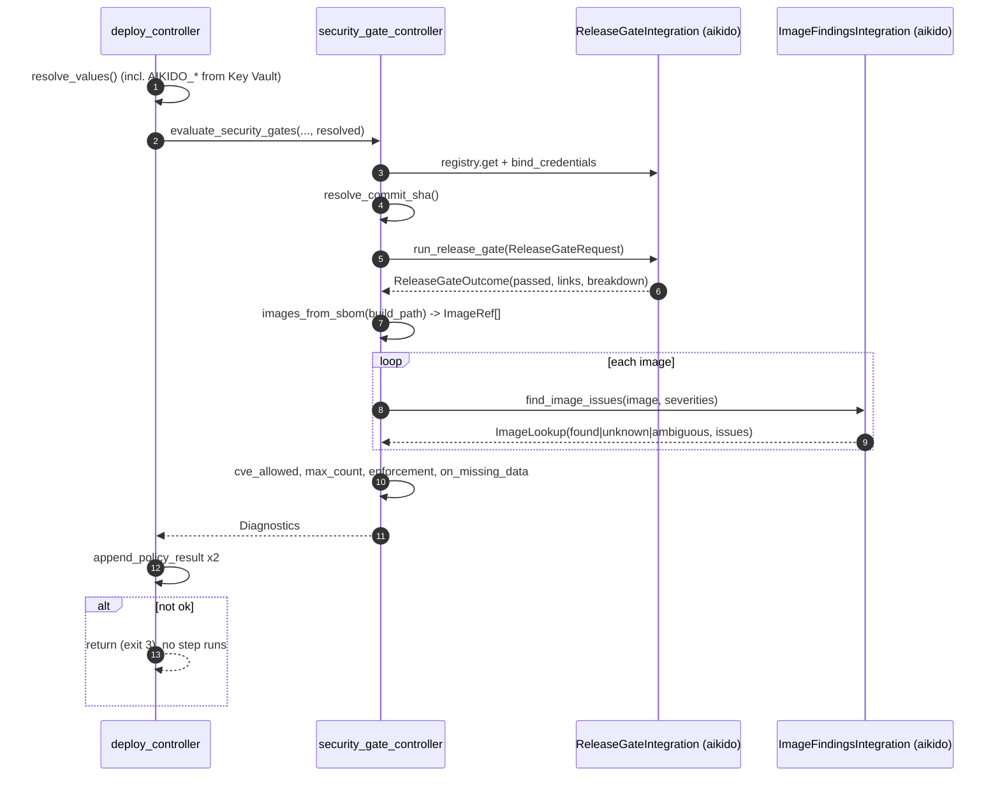

# Security gates (release gate, image gate) - Design

- Status: current
- Last updated: 2026-10-28
- Target: strata 2.x (2.0.0rc2, `v2-beta`)
- Vendor reference: [aikido-api-reference.md](../archive/aikido-api-reference.md) - Appendix A (offline Aikido API), B (fixtures), C (code anchors), D (sources)
- Related: ADR-0003 (layering), ADR-0004 (exit codes), ADR-0021 (integration layer), ADR-0022 D4 (build renders, deploy resolves), [cve-scanner-integration.md](../archive/cve-scanner-integration.md), [checkov-integration.md](../archive/checkov-integration.md), [integration-readiness.md](../work/integration-readiness.md)

> Facts about Aikido in the vendor reference are labelled **[V]** (verified against a primary source)
> or **[U]** (not yet confirmed against a live workspace, see section 12). This design replaces that
> document's sections 1-13 and reuses its Aikido-specific reasoning where noted ("ref D7" =
> aikido-api-reference.md decision D7).

---

## 1. Summary

Add two **vendor-neutral deploy gates** to strata, with
[Aikido Security](https://www.aikido.dev) as their first implementation:

1. **Release gate** - before `deploy run` touches any provisioner, ask a security platform
   whether the solution's repository at the commit being deployed passes its release gate.
2. **Image gate** - for every container image in the `sbom.json` that `build run` already
   writes, ask a security platform for its open issues and count them against a threshold,
   honouring the existing `cve_allowed` allowlist.

Each gate is a **capability** (`release_gate`, `image_findings`) that any integration can
implement. Aikido implements both. The CLI and the workspace policies are named after what they
do, never after a vendor. The commands are not security-specific: they belong to a general
`strata policy` group that every workspace policy (CVE, Checkov, these gates, a future OPA policy)
can join (D7):

```
strata policy list <deployment>        # configured policies and their last recorded result
strata policy check <deployment>       # evaluate policies now (the gates, cve_policy, checkov_policy)
strata policy findings <deployment>    # read-only detail (the image gate, cve_policy, checkov_policy)
strata integration check <name>        # credentials and reachability of one integration
```

Both gates behave like the existing `cve_policy` and `checkov_policy`: workspace-scoped,
`enforcement: deny | warn`, `on_missing_data: skip | warn | block`, reported as `Diagnostics`,
recorded in `policy_results.json` for the audit manifest.

## 2. Context

### 2.1 Why generic

Every strata command is named after a function, and vendors sit behind it as integrations:
`values` (infisical, azure-keyvault, azure-appconfig), `deploy` (terraform, helm, compose,
argocd, flux, script), `audit` (webhook, sentinel, otel). A `strata aikido` command would be the
first vendor-named command, and renaming a CLI command later breaks every consumer pipeline.
Integrations already declare **capabilities** (`integrations/capabilities.py`); a policy asks for a
capability, not a product. So this design adds two narrow capabilities rather than a
"devsecops platform" type: platforms differ in which slices they cover, and a grab-bag base class
would force every implementation to stub half of it.

| Capability       | Question it answers                    | Aikido              | Plausible later implementations                                |
| ---------------- | -------------------------------------- | ------------------- | -------------------------------------------------------------- |
| `release_gate`   | "Does repository X at commit Y pass?"  | CI API scan-release | GitHub Advanced Security, Snyk, SonarQube quality gate         |
| `image_findings` | "Which open issues does image Z have?" | REST issues export  | Defender for Cloud, Snyk Container, a local Trivy/Grype lookup |

### 2.2 What strata already has (verified in this repo)

| Capability                                                                           | Where                                                                                                                                           |
| ------------------------------------------------------------------------------------ | ----------------------------------------------------------------------------------------------------------------------------------------------- |
| Capability enum, capability ABCs, `CAPABILITY_ABCS`, `find_capability_mismatches()`  | `models/integration_model.py::Capability`, `integrations/capabilities.py`                                                                       |
| Registry: `get(type, config)`, `get_class(type)`, `_KNOWN`                           | `integrations/registry.py`                                                                                                                      |
| Workspace field naming an Integration document + resolver requiring a capability ABC | `WorkspaceSpecModel.output_store_integration`, `integration_resolution.resolve_output_store_integration()` / `_require_key_value_integration()` |
| CVE gate (template for policy shape, allowlist, `on_missing_data`)                   | `controllers/sbom_controller.py::evaluate_cve_policy`, `_apply_allowlist`, `_report_missing_data`                                               |
| SBOM with container components (`name` = service, purl = image)                      | `controllers/sbom_controller.py::write_sbom`, `utils/sbom_utils.py::image_to_purl`                                                              |
| Policy results sidecar read by audit finalize                                        | `controllers/policy_results.py`, `controllers/audit_run.py`                                                                                     |
| Deploy resolves all values before any step; redaction set                            | `controllers/deploy_controller.py::deploy_run` (`resolve_values`, `secret_values`, `_MIN_REDACT_LENGTH`, `smoke_test`)                          |
| HTTP transport returning, not raising, on 4xx/5xx                                    | `utils/transport.py::http_request`, `HttpResult`, `NO_RESPONSE`                                                                                 |

## 3. Goals and non-goals

**Goals**

- G1. Gate every `deploy_run()` entry point (except `--smoke-test`) on a release-gate verdict for the solution repository at the deployed commit.
- G2. Gate it on open issues of the container images in `sbom.json`.
- G3. Vendor-neutral policies, capabilities, commands and diagnostic codes; vendor detail lives only in the integration class and its Integration document.
- G4. Credentials resolved through strata's value pipeline (Key Vault, Infisical, GitHub, environment), never in a document.
- G5. Outcomes recorded in `policy_results.json` (audit manifest).
- G6. `strata policy list | check | findings` and `strata integration check` for CI use.
- G7. Aikido as the first implementation of both capabilities. No new runtime dependency.

**Non-goals** - see D10.

## 4. Decisions

### D1 - Two capabilities, two ABCs, neutral result types

`Capability` gains two values (same `snake_case` style as `key_value`), each with a rationale
comment like its neighbours:

```python
# A remote service's pass/fail verdict on a repository at a commit. Not `scanner`: that
# capability's ABC is about a *locally installed* tool (`ensure_available()`), and its own
# docstring refuses a shared scan() signature; this is a verdict lookup, nothing runs locally.
RELEASE_GATE = "release_gate"      #: Pass/fail verdict for a repository at a commit
# A remote service's open issues for one container image (same "not scanner" reasoning).
IMAGE_FINDINGS = "image_findings"  #: Open security issues for a container image
```

`integrations/capabilities.py` gains two ABCs, registered in `CAPABILITY_ABCS`:

```python
class ReleaseGateIntegration(Integration):
    """A platform that can judge a repository at a commit (docs/design/security-gates.md D1)."""

    @abstractmethod
    def run_release_gate(
        self, request: ReleaseGateRequest, *, on_poll: Callable[[int], None] | None = None
    ) -> ReleaseGateOutcome:
        """Start (or look up) the platform's release check and wait for its verdict.

        Raises:
            GateNotFoundError: The platform does not know the repository or commit (configuration
                error; never retried, never treated as missing data).
            GateTimeoutError: No verdict within `request.timeout`.
            IntegrationError: Any other failure (unreachable, auth, unparseable).
        """


class ImageFindingsIntegration(Integration):
    """A platform that can list open issues for a container image (D1)."""

    @abstractmethod
    def find_image_issues(self, image: ImageRef, severities: frozenset[str]) -> ImageLookup:
        """Open issues for `image` at the given severities (`SECURITY_SEVERITY_ORDER` values).

        Unknown or ambiguous images are a result (`ImageLookup.status`), not an exception;
        `IntegrationError` means the platform could not answer at all.
        """
```

Neutral types live in a new `integrations/security_findings.py` (frozen dataclasses, not
`PlatformBaseModel`, which forbids extra fields):

```python
# Same values and order as CVE_SEVERITY_ORDER / CHECKOV_SEVERITY_ORDER (deliberately a separate
# constant, as checkov_model does). Vendors map their own vocabulary onto it; anything they cannot
# map is UNKNOWN, which - exactly as in evaluate_cve_policy() - is never counted against a
# max_severity (whose Literal stops at LOW).
SECURITY_SEVERITY_ORDER = ("CRITICAL", "HIGH", "MEDIUM", "LOW", "UNKNOWN")  # most severe first

@dataclass(frozen=True)
class ReleaseGateRequest:
    repository: str
    commit: str              # 40 lowercase hex, validated by the controller
    timeout: int             # seconds, total
    poll_interval: int       # seconds

@dataclass(frozen=True)
class ReleaseGateOutcome:
    passed: bool
    reference: str | None = None                     # e.g. Aikido scan_id, for messages/audit
    open_issues: int | None = None
    breakdown: Mapping[str, Mapping[str, int]] = field(default_factory=dict)  # category -> severity -> n
    links: tuple[str, ...] = ()
    detail: str | None = None                        # one-line vendor summary

@dataclass(frozen=True)
class ImageRef:
    service: str             # SBOM component name (compose/module service), for messages
    registry: str | None     # e.g. "ghcr.io", "registry:5000"; None for Docker Hub short names
    repository: str          # path without registry, e.g. "huybrechtsxyz/api"
    tag: str | None          # same split as utils/sbom_utils.parse_image_ref(): (name, tag, digest)
    digest: str | None       # e.g. "sha256:abc123"; when set, the SBOM carries no tag (see below)

    @property
    def path(self) -> str:   # registry + repository, no tag/digest
        ...

@dataclass(frozen=True)
class SecurityIssue:
    id: str
    severity: str            # one of SECURITY_SEVERITY_ORDER (uppercase)
    status: str
    cve_id: str | None = None
    package: str | None = None
    link: str | None = None

@dataclass(frozen=True)
class ImageLookup:
    status: Literal["found", "unknown", "ambiguous"]
    platform_name: str | None = None                 # the platform's own name for the image
    issues: tuple[SecurityIssue, ...] = ()
    detail: str | None = None
```

The two gate exceptions go in `integrations/errors.py`, next to the existing `IntegrationError`
subclasses (`CheckPhaseUnsupportedError`, `RegistryAuthError`, `KeyValueConflictError`):

```python
class GateNotFoundError(IntegrationError): ...   # platform doesn't know the repository/commit
class GateTimeoutError(IntegrationError): ...    # no verdict within the request's timeout
```

**Building an `ImageRef`** (controller, D6): the SBOM's container components carry
`purl = image_to_purl(image)`, i.e. `pkg:docker/<name>@<digest or tag>`. `PackageURL.from_string()`
parses every shape strata writes (verified: `ghcr.io/huybrechtsxyz/api@1.4.2`,
`postgres@sha256:abc123`, `registry:5000/img@latest`, `traefik` with no version). `namespace/name`
is the full image name; the version is a **digest when it contains `:`** (a tag never can),
otherwise a tag. The registry is split off by a new `utils/sbom_utils.split_registry(name) ->
tuple[str | None, str]` next to `parse_image_ref()`: the first path segment is a registry when it
contains `.` or `:` or equals `localhost` (Docker's own rule). Because `image_to_purl()` prefers the
digest, an image pinned by digest arrives **without its tag**, so a vendor option that matches by tag
(Aikido `images.require_tag_match`) can never match it; that is correct, and documented as such.

`AikidoIntegration(ReleaseGateIntegration, ImageFindingsIntegration)` declares
`CAPABILITIES = {RELEASE_GATE, IMAGE_FINDINGS}`; `find_capability_mismatches()` keeps the pairing
honest. A future vendor implements only what it supports.

### D2 - Credentials: `AuthenticationModel` key references, one Integration document per credential

Credentials reuse the mechanism git remotes and Helm/OCI registries already use: the Integration
document's `spec.authentication` (`models/auth_models.py`), whose fields are **key references**
resolved through `resolve_values()` from Environment declarations (any store: Key Vault, Infisical,
App Config, GitHub, environment, constant). No new credential mechanism.

`AuthenticationModel` allows exactly one method per document
(`validate_method_matches_populated_config`). A vendor that needs two unrelated credentials (Aikido:
a CI token for the release gate, OAuth client credentials for the image gate) is configured as **two
Integration documents of the same type**, each declaring only the capability its credential serves
(§5.1). The capability split (D1) is what makes this natural.

Pieces:

- `AuthenticationModel.key_references() -> tuple[str, ...]` (new, model layer): every key reference
  the active method's block sets. Implemented for `token` (token), `ssh_key` (private_key,
  passphrase, known_hosts), `api_key` (api_key, api_secret, endpoint, header_name) and `oauth2`
  (client_id, client_secret, tenant_id, token_url, authorization_url, scope); other methods return
  `()` until a consumer needs them. Literal fields (`token.username`) and booleans are never
  included. `integrations/git_push.credential_keys()` is left as is (its git-specific contract is
  documented there); it can delegate later.
- `CredentialedIntegration` (small mixin in `capabilities.py`, not a capability):

  ```python
  class CredentialedIntegration(Integration):
      """An integration whose `spec.authentication` keys strata resolves before use (D2)."""

      def bind_credentials(self, values: Mapping[str, str]) -> None:
          """Receive the resolved value for every `spec.authentication.key_references()` key.

          Called before any capability method; with no `authentication` block it is called with an
          empty mapping and the class may fall back to its own environment variables.
          """
  ```

- The controller (D6) does what `remote_credentials.py` does: keys from `key_references()`, values
  from the deploy's already-resolved set (or `resolve_values()` outside a deploy), every value
  of at least `_MIN_REDACT_LENGTH` added to the redaction set, then `bind_credentials()`. A key that
  does not resolve is a hard error (`integration_credentials_unresolved`, names the key, never the
  value).
- No `authentication` block means the vendor's environment variables, the same "ambient" reading
  remotes give a missing block (Aikido: `AIKIDO_CI_TOKEN`, alias `AIKIDO_API_KEY`;
  `AIKIDO_CLIENT_ID`, `AIKIDO_CLIENT_SECRET`; ref D3). `integrations` never imports `controllers`
  (ADR-0003).

### D3 - Workspace policies: `release_gate_policy`, `image_gate_policy`, generic fields only

Two optional fields on `WorkspaceSpecModel`, beside `cve_policy` and `checkov_policy`. Each names
its Integration document explicitly (`References(PlatformKind.INTEGRATION)`, like
`output_store_integration`). No auto-bind: two capabilities and possibly several documents of one
type make an explicit name the clearer contract (auto-bind by capability can come later, D10).

Only what any vendor understands goes in the policy (§5.3, §6.1). Validation follows the two
existing precedents, both at once:

- the named document must be enabled and **declare** the capability in `spec.capabilities` (the
  remote/asset `sources` checks: `remote_integration_not_sources`) -> `gate_integration_capability_missing`;
- its type's class must **implement** the capability, checked class-only with
  `issubclass(registry.get_class(type), ReleaseGateIntegration | ImageFindingsIntegration)` (the
  output-store CAS check, `_check_workspace_key_value_store_supports_cas`) ->
  `gate_integration_type_unsupported`. An unregistered type is skipped here, as that check does; it
  is reported louder elsewhere.

### D4 - Vendor knobs live on the Integration document

Vendor-specific options (Aikido's `fail_on` categories, `minimum_severity`, `sla_mode`,
`base_branch`; its image-name mapping) sit under the Integration document's `spec.configuration`,
validated by the vendor class at construction (raises `IntegrationError`, reported as
`integration_configuration_invalid`). Two workspaces that need different Aikido thresholds declare
two Integration documents (`aikido-strict`, `aikido-relaxed`) - no new mechanism, the existing
document model already supports it.

### D5 - Gates run at deploy preflight

Unchanged from ref D4: after `resolve_values()` succeeds, before the first step, for every
`deploy_run()` entry point. `--smoke-test` makes no call (reports `would run release_gate_policy,
image_gate_policy`); `--dry-run` runs the gates. `build run` never runs them (no network, no
secrets; ADR-0022 D4). Release gate first, then image gate; the image gate runs even when the
release gate already failed, so one run shows every problem. A not-ok result returns before any
step.

### D6 - The generic controller owns everything vendor-neutral

`controllers/security_gate_controller.py` owns: resolving the integrations (D3), credentials
(D2), the commit SHA (ref D7 order: policy `commit`, `STRATA_COMMIT_SHA`, `GITHUB_SHA`,
`BUILD_SOURCEVERSION`, `CI_COMMIT_SHA`, `BITBUCKET_COMMIT`, `GIT_COMMIT`, `git rev-parse HEAD` at the
solution root; 40-hex validation), SBOM image extraction to `ImageRef` (purl-derived via
`split_registry()`, D1), the `cve_allowed` allowlist, threshold counting, `enforcement`/`on_missing_data`, diagnostics
and policy results. The vendor class owns only the API conversation and how it names images
(ref D8 second half, now Aikido configuration).

### D6a - A pinned commit that differs from the run's commit

The policy's `commit` comes before the CI variables, so a pin left in the workspace after testing
keeps judging an old commit while CI deploys a newer one: an old pass lets every new deploy
through, and only "via policy commit" in the step line hints at it.

- When the commit judged comes from `release_gate_policy.commit` **and** a CI variable
  (`STRATA_COMMIT_SHA`, `GITHUB_SHA`, ... the D6 list) holds a different valid commit, the gate
  reports `release_gate_commit_mismatch`, naming both commits and the variable.
- Severity follows `enforcement`: `warn` -> warning and the gate continues with the pinned commit;
  `deny` -> error and the gate stops before asking the platform (the deploy would fail anyway).
- Not checked: `--commit` (an explicit per-run choice, so it is how a deliberate pin is
  expressed under `deny`), and `git rev-parse HEAD` (outside CI a pin is usually deliberate).
- No new policy field: a lasting deliberate pin belongs in the pipeline's `--commit`, not in a
  shared workspace document.

### D7 - Commands: a general `strata policy` group, plus `strata integration check`

**Why `policy`, not `security`.** "Policy" is already the shared concept in strata: the
workspace fields (`cve_policy`, `checkov_policy`, `release_gate_policy`, `image_gate_policy`), the
audit file (`policy_results.json`, `ManifestPolicyResultModel` with `phase: validate | build | plan
| deploy`) and [policy-engine-architecture.md](../work/policy-engine-architecture.md). The policies differ
in what checks them (a local tool or an integration) and when (build or deploy), but share one
lifecycle: configured on the workspace, evaluated, enforced `deny`/`warn`, recorded. `security`
would exclude a future OPA policy, which typically checks tags, naming, regions or cost. `gate`
sounds deploy-only, `compliance` sounds like reporting, and `check` clashes with `deploy check`
and `integration check`. `audit` stays as is: it reads back what happened; `policy` evaluates now.

**Bespoke, not an engine.** A small table in `controllers/policy_controller.py` maps each policy
field to its phase, what backs it, and the functions that evaluate it and list its findings. That
is a dispatch table, not a generic policy model, so it stays within
policy-engine-architecture.md's "bespoke, no generic engine" decision. A new policy adds its field,
its evaluator and one table row; `list`, `check` and the audit record then work unchanged.

**Scope.** `policy check` evaluates `cve_policy`, `checkov_policy` and the two gate policies;
`policy findings` lists itemised findings for the image gate, `cve_policy` and `checkov_policy` (the
release gate has no itemised API). A future policy adds its field, its evaluator and one table row.
`cve_policy` is recorded with `phase: "build"`, the same verdict as `build run`, and `findings` lists
each CVE with allowlisted ones marked (`--severity` defaults to `severity_threshold`, else
`max_severity`). `checkov_policy` re-derives the rendered source paths from the model (no
build-output change); `findings` lists failed checks per provisioner or Helm module. A failed check
with no severity (open-source Checkov reports none) counts against the gate at any `severity_gate`
and is marked `[unrated]`.

| Command                                                                                     | Purpose                                                                                                                                                                                                                                                                                                                                                                                                  | Exit                                                                                                                                                                                           |
| ------------------------------------------------------------------------------------------- | -------------------------------------------------------------------------------------------------------------------------------------------------------------------------------------------------------------------------------------------------------------------------------------------------------------------------------------------------------------------------------------------------------- | ---------------------------------------------------------------------------------------------------------------------------------------------------------------------------------------------- |
| `strata policy list <deployment>`                                                           | Every policy the workspace configures: name, phase, enforcement, what backs it (`trivy`, `checkov`, `aikido 'aikido-ci'`), whether `policy check` can run it, and its last result from `policy_results.json` under the build path. Read-only, no network.                                                                                                                                                | 0; 2 unknown deployment                                                                                                                                                                        |
| `strata policy check <deployment> [--policy NAME ...] [--commit SHA]`                       | Evaluate the selected policies now (default: every policy `check` supports and the workspace configures), exactly as the deploy does; append the results to `policy_results.json` when the build path exists.                                                                                                                                                                                            | 0 pass (a `warn` breach too); 2 nothing to check, or `--policy` names one that is not configured or not yet supported; 3 a `deny` breach, missing data under `block`, or a configuration error |
| `strata policy findings <deployment> --policy NAME [--severity LEVEL] [--integration NAME]` | Read-only detail for a policy that produces itemised findings: per image, the platform's name, status, counts by severity and up to 10 issues; issues the `cve_allowed` allowlist would suppress are shown and marked, not hidden. `--severity` defaults to the policy's `max_severity`, else `HIGH`. `--integration` lets the image gate's lookup run without a policy configured (before adopting it). | 0 listed; 1 platform unreachable or credentials rejected; 2 unsupported policy, no integration, or no `sbom.json`                                                                              |
| `strata integration check <name> [--deployment D]`                                          | Verify one integration's credentials and reachability. With `--deployment`, the document's `authentication` key references are resolved through that deployment, as deploy resolves them; without it, only a document with no `authentication` block (environment fallback) can be checked.                                                                                                              | 0 ok; 1 unreachable; 2 unknown name, or `--deployment` needed; 3 credentials missing, rejected or unresolved                                                                                   |

Common options on the `policy` commands, mirroring `deploy`: `--path`, `--build-path` (default
`<solution root>/build/<deployment>`), `--pin` (so credentials resolve exactly as a `deploy --pin`
run would), `--output console|json`, `--quiet`, `--verbose`. A gate that cannot be confirmed
(an outage under `on_missing_data: block`) exits 3, not 1: inside `policy check` as inside a
deploy, "could not confirm" fails the gate.

`integration check` uses a small mixin, `ConnectionCheckIntegration.check_connection() ->
list[str]` (one line per verified aspect; raises `IntegrationError` on failure). Only Aikido
implements it now; any integration can add it later, which is why it is not under `policy`.
The command also checks local readiness first and accepts a type name; a type without a connection
check passes on local readiness (exit 0) and a disabled integration exits 3 (integration-readiness.md
D9-D13, [ADR-0050](../decisions/0050-one-offline-integration-readiness-check.md)).
A credential that is missing or rejected (HTTP 401/403) is raised as `IntegrationCredentialError`,
a subclass, so the command can tell exit 3 (fix the credential) from exit 1 (platform unreachable).

Each table row carries its own check function (the gate rows call
`evaluate_security_gates(..., only=<gate>)`), so a new policy adds exactly one function and one
row. A `--policy` that `check` does not support is a usage error. `policy findings` also exits 3 when
the integration is misconfigured or its declared credentials do not resolve.

All commands honour `--output json` / `STRATA_OUTPUT=json` via the existing command machinery.

### D8 - Diagnostic codes are generic; the integration name goes in the message

See §8. Example: `release_gate_policy: FAILED via aikido 'aikido-ci' for 'huybrechtsxyz/infra'
@ 1c5a7dd... - 2 open issue(s) (sca: 1 critical; secrets: 1 critical). https://...`

### D9 - Policy results

Two entries, mirroring `build_controller._cve_policy_result()`:
`ManifestPolicyResultModel(policy_name="release_gate_policy" | "image_gate_policy",
policy_type=<integration type, e.g. "aikido">, phase="deploy", enforcement=..., passed=...,
violations=[...])`, merged into the existing `policy_results.json` by a new
`policy_results.append_policy_result()` (replace same `policy_name`, keep the rest). Audit
finalize picks them up unchanged.

### D10 - Deferred, with reasons

| Item                                                                                  | Why deferred                                                                                                                                   |
| ------------------------------------------------------------------------------------- | ---------------------------------------------------------------------------------------------------------------------------------------------- |
| A future `opa_policy` in `strata policy`                                              | Only on real consumer demand for policy-as-code (tags, naming, regions, cost): it would add a capability, a workspace field and one table row. |
| Merging `image_gate_policy` with `cve_policy` (`source: trivy \| grype \| aikido`)    | Reworks a shipped feature; wait until both run in real pipelines.                                                                              |
| Auto-bind by capability (policy without `integration`)                                | Explicit is clearer with several documents; add if repetition becomes a burden.                                                                |
| A second vendor                                                                       | Build exactly one until a consumer needs another.                                                                                              |
| Upload of Checkov results / SBOM to Aikido; `aikido-local-scanner` on rendered output | Ref D12 (SARIF / Syft JSON formats; network from `build run`).                                                                                 |
| PR gating, webhooks, write-back (snooze/ignore)                                       | Ref D12.                                                                                                                                       |

### D11 - Aikido as the first implementation

`integrations/aikido.py`, `TYPE = "aikido"`, `TRANSPORTS = {"http"}`, `COMMAND = None`, classes
`ReleaseGateIntegration`, `ImageFindingsIntegration`, `CredentialedIntegration`,
`ConnectionCheckIntegration`. Behaviour is the earlier design, reused:

| Concern                                                                                                                                                                                                                                                                     | Source                 |
| --------------------------------------------------------------------------------------------------------------------------------------------------------------------------------------------------------------------------------------------------------------------------- | ---------------------- |
| Two APIs, two credentials (CI token for the release gate; OAuth client credentials for the image gate)                                                                                                                                                                      | ref D2, Appendix A.2   |
| Credentials from `spec.authentication`: `api_key` (its `api_key` field = the CI token, sent as `X-AIK-API-SECRET`) serves `release_gate` only; `oauth2` (`client_id`, `client_secret`) serves `image_findings` only; no block = env vars for whatever the document declares | D2                     |
| Host/region resolution                                                                                                                                                                                                                                                      | ref §5.1, Appendix A.1 |
| CI API start + poll; exact request body; `gate_passed is True`; polling semantics                                                                                                                                                                                           | ref §6.2, Appendix A.3 |
| OAuth token (JSON then form fallback, cache), containers lookup, issues export, envelope tolerance, paging caps                                                                                                                                                             | ref §6.2, Appendix A.4 |
| Retries (429/5xx/no response, `Retry-After`, cap 60 s), error text never containing credentials                                                                                                                                                                             | ref §6.2               |
| `check_connection()`: OAuth token if client credentials set; CI token probe (`scan_id=0`) if CI token set                                                                                                                                                                   | ref A.3.4              |

Changes from the earlier design: `run_release_gate()` takes a `ReleaseGateRequest` and reads
`fail_on`/`minimum_severity`/`sla_mode`/`base_branch` from its own configuration;
`find_image_issues()` maps an `ImageRef` to the Aikido container name using its configuration
(`images.name_strategy`, `images.names`, `images.require_tag_match`), returns `ImageLookup` with
`status="unknown"` / `"ambiguous"` instead of raising, and maps Aikido issues to `SecurityIssue`
(Aikido's lowercase `critical|high|medium|low` to the uppercase vocabulary, anything else to
`UNKNOWN`; outgoing `filter_severities` is lowercased for Aikido's API).
A 404 with `reason_phrase` on scan start raises `GateNotFoundError`; a poll timeout raises
`GateTimeoutError`.

When several Aikido containers share the image's name (Aikido may list one per tag, reference R3),
the one carrying the deployed tag is used; only when none or several do is the result `ambiguous`.

The constructor rejects (`integration_configuration_invalid`), so nothing is silently ignored:

- an authentication method other than `api_key`/`oauth2`;
- `api_key` together with a declared `image_findings`, or `oauth2` together with `release_gate`;
- fields Aikido does not use: `api_key.api_secret`/`endpoint`/`header_name` (Aikido's header is
  fixed) and `oauth2.tenant_id`/`token_url`/`authorization_url`/`scope`;
- a `release_gate` configuration block on a document not declaring `release_gate`, or an `images`
  block on one not declaring `image_findings`.

## 5. Configuration reference

### 5.1 Integration documents (Aikido)

One document per credential (D2). Shared settings (`region`, `http_timeout`, `max_retries`,
`endpoints`) are repeated on both.

```yaml
apiVersion: strata.huybrechts.xyz/v2
kind: integration
meta:
  name: aikido-ci
spec:
  type: aikido
  capabilities: [release_gate]
  enabled: true
  authentication:               # omit to use AIKIDO_CI_TOKEN from the environment
    method: api_key
    api_key:
      api_key: AIKIDO_CI_TOKEN  # key reference (D2)
  # endpoints:
  #   address: https://app.aikido.dev     # optional; overrides region
  configuration:
    region: eu                  # eu | us | me | au | us-gov (ref §5.1)
    http_timeout: 30
    max_retries: 3
    release_gate:               # Aikido-specific (D4)
      minimum_severity: high    # critical | high | medium | low
      fail_on: [dependency, iac, secrets]   # + sast, malware
      sla_mode: false
      base_branch: main         # optional
---
apiVersion: strata.huybrechts.xyz/v2
kind: integration
meta:
  name: aikido-api
spec:
  type: aikido
  capabilities: [image_findings]
  enabled: true
  authentication:               # omit to use AIKIDO_CLIENT_ID / AIKIDO_CLIENT_SECRET
    method: oauth2
    oauth2:
      client_id: AIKIDO_CLIENT_ID
      client_secret: AIKIDO_CLIENT_SECRET
  configuration:
    region: eu
    images:                     # Aikido-specific image naming (ref D8)
      name_strategy: repository # repository | full
      require_tag_match: false  # a digest-pinned image never matches by tag (D1)
      names:                    # image path (registry + repository, no tag) -> Aikido container name
        ghcr.io/huybrechtsxyz/api: huybrechtsxyz/api
```

Allowed `configuration` keys are exactly those above; anything else is
`integration_configuration_invalid`, as are the D11 authentication/capability mismatches.
Defaults: `http_timeout` 30 (int >= 1), `max_retries` 3 (0-10), `release_gate.minimum_severity`
`high`, `release_gate.fail_on` `[dependency, iac, secrets]` (no duplicates), `sla_mode` false,
`images.name_strategy` `repository`, `images.require_tag_match` false.

### 5.2 Credentials

Declared in an Environment reachable from the deployment, any store (ref §5.2 has the full
example):

```yaml
spec:
  secrets:
    - { key: AIKIDO_CI_TOKEN, store: azure-keyvault, value: aikido-ci-token }
    - { key: AIKIDO_CLIENT_SECRET, store: azure-keyvault, value: aikido-client-secret }
  variables:
    - { key: AIKIDO_CLIENT_ID, store: constant, value: "aik_client_xxxxxxxx" }
```

### 5.3 Workspace policies

```yaml
kind: workspace
spec:
  release_gate_policy:
    integration: aikido-ci        # required; must declare release_gate
    repository: huybrechtsxyz/strata-infra   # the platform's repository id or name
    enforcement: deny             # deny | warn
    on_missing_data: block        # skip | warn | block
    timeout: 900                  # 30-7200 s, total poll budget
    poll_interval: 10             # 2-300 s, < timeout
    # commit: <40 hex>            # optional pin (D6 resolution order)
  image_gate_policy:
    integration: aikido-api       # required; must declare image_findings
    enforcement: deny
    on_missing_data: block
    max_severity: HIGH            # CRITICAL | HIGH | MEDIUM | LOW (same vocabulary as cve_policy)
    max_count: 0
    on_unknown_image: warn        # skip | warn | block
```

## 6. Component design

### 6.1 Models - `models/security_gate_model.py`

```python
class ReleaseGatePolicyModel(PlatformBaseModel):
    integration: Annotated[PlatformName, References(PlatformKind.INTEGRATION)]
    repository: str = Field(min_length=1)
    enforcement: Literal["deny", "warn"] = "deny"
    on_missing_data: Literal["skip", "warn", "block"] = "block"
    timeout: int = Field(default=900, ge=30, le=7200)
    poll_interval: int = Field(default=10, ge=2, le=300)
    commit: str | None = Field(None, pattern=r"^[0-9a-fA-F]{40}$")
    # model_validator: poll_interval < timeout

class ImageGatePolicyModel(PlatformBaseModel):
    integration: Annotated[PlatformName, References(PlatformKind.INTEGRATION)]
    enforcement: Literal["deny", "warn"] = "deny"
    on_missing_data: Literal["skip", "warn", "block"] = "block"
    max_severity: Literal["CRITICAL", "HIGH", "MEDIUM", "LOW"] = "HIGH"
    max_count: int = Field(default=0, ge=0)
    on_unknown_image: Literal["skip", "warn", "block"] = "warn"
```

`WorkspaceSpecModel` gains `release_gate_policy: ReleaseGatePolicyModel | None` and
`image_gate_policy: ImageGatePolicyModel | None`, after `checkov_policy`, with descriptions
pointing here. JSON schemas regenerate from the models (`sln update`).

Semantic check (`controllers/semantic_checks.py`, next to existing workspace checks), per set
policy, following D3's two precedents: named document disabled or not declaring the capability ->
`gate_integration_capability_missing`; its class not a subclass of the capability's ABC
(`registry.get_class()`, no construction) -> `gate_integration_type_unsupported`; unregistered type
-> skipped (reported elsewhere, as `_check_workspace_key_value_store_supports_cas` does).

### 6.2 Integration layer

- `integrations/security_findings.py`: D1 types and `SECURITY_SEVERITY_ORDER`.
- `integrations/errors.py`: `GateNotFoundError`, `GateTimeoutError`.
- `utils/sbom_utils.py`: `split_registry()` next to `parse_image_ref()`.
- `integrations/capabilities.py`: `ReleaseGateIntegration`, `ImageFindingsIntegration`,
  `CredentialedIntegration`, `ConnectionCheckIntegration`; two new `CAPABILITY_ABCS` entries.
- `models/integration_model.py`: two `Capability` values.
- `models/auth_models.py`: `AuthenticationModel.key_references()` (D2).
- `integrations/aikido.py`: D11.
- `integrations/registry.py`: `_KNOWN["aikido"] = ("strata.integrations.aikido", "AikidoIntegration")`.

### 6.3 Controller - `controllers/security_gate_controller.py`

```python
Gate = Literal["release", "images"]

def _resolve_integration(index, name, capability_abc, field_name, diagnostics) -> Integration | None
    # named document -> registry.get(type, config) -> isinstance check (mirrors
    # resolve_output_store_integration / _require_key_value_integration), but reports a diagnostic
    # instead of raising, so each gate's own policy decides how the deploy reacts
def bind_resolved_credentials(context, integration, resolved, deployment_name, *,
                              version_pin=None, on_secret=None) -> Diagnostics
    # D2: keys = spec.authentication.key_references() (or () without a block); values from
    # `resolved` on the deploy path, else resolve_values(); no-op for non-CredentialedIntegration
def resolve_commit_sha(context, policy, diagnostics, override=None) -> tuple[str | None, str]
    # invalid values warn into `diagnostics` (release_gate_commit_invalid) and the next source is tried
def images_from_sbom(build_path) -> list[ImageRef] | None      # None: no sbom.json; ValueError: unreadable
def evaluate_security_gates(
    context, deployment_name, workspace, build_path, *, resolved, version_pin=None,
    commit_override=None, only: Gate | None = None,
    on_step=None, on_secret: Callable[[str], None] | None = None,
) -> SecurityGateEvaluation
def list_image_findings(
    context, deployment_name, build_path, integration_name, max_severity, *,
    version_pin=None, on_step=None,
) -> ImageFindingsReport
    # `strata policy findings` (D7): same resolution, credentials and allowlist as the image gate,
    # but allowlisted issues are marked, not dropped, and nothing is judged or recorded

@dataclass
class SecurityGateEvaluation:      # each gate's Diagnostics kept apart (D9: one audit entry per gate)
    release: Diagnostics | None
    images: Diagnostics | None
    @property
    def diagnostics(self) -> Diagnostics                                     # both combined
    def policy_results(self, workspace) -> list[ManifestPolicyResultModel]  # replaces security_gate_results()

@dataclass(frozen=True)
class ImageFindings:               # one SBOM image: platform name, lookup status, issues, allowlisted ids
@dataclass(frozen=True)
class ImageFindingsReport:         # integration label, severities listed, one ImageFindings per image
```

Rules: integration calls are wrapped; `GateNotFoundError` is a hard error
(`release_gate_repository_not_found`) whatever `on_missing_data` says; every other
`IntegrationError` (including `GateTimeoutError`) goes through that gate's `on_missing_data`
(`release_gate_missing_data` / `image_gate_missing_data`). Severities at or above the threshold:
`SECURITY_SEVERITY_ORDER[: index(max_severity) + 1]` (so `UNKNOWN` is never counted, as in
`evaluate_cve_policy()`). The allowlist follows
`sbom_controller._apply_allowlist` semantics (CVE id, optional package, active `expires`) over
`SecurityIssue`; issues without `cve_id` cannot be allowlisted. Every resolved credential value is
passed to `on_secret` (as `remote_credentials.py` adds its values to the secret set); the deploy
hook applies `_MIN_REDACT_LENGTH`, which lives in `deploy_controller` (importing it here would be
circular). The controller does not log: progress goes to `on_step`, results to `Diagnostics`.

### 6.4 Deploy hook - `controllers/deploy_controller.py`

After the `resolve_values()` early return and the redaction set (`secret_values`/`_redact`), so gate
credentials join it before any step output:

```python
if workspace.spec.release_gate_policy is not None or workspace.spec.image_gate_policy is not None:
    if smoke_test:
        _step("would run security gates (release_gate_policy / image_gate_policy)")
    else:
        gates = evaluate_security_gates(
            context, deployment_name, workspace, build_path,
            resolved=resolved, version_pin=pin, on_step=_step, on_secret=_add_secret,
        )
        gate_diagnostics = gates.diagnostics
        diagnostics.extend(gate_diagnostics)
        if build_path.is_dir():
            for result in gates.policy_results(workspace):
                append_policy_result(build_path, result)
        if not gate_diagnostics.ok:
            return diagnostics
```

(`_add_secret` adds a value to `secret_values` when it is at least `_MIN_REDACT_LENGTH` long. A
later general `if not diagnostics.ok` before the steps would also stop the deploy; the hook's own
return stops it earlier, before graph and payload work.)

### 6.5 Policy results - `controllers/policy_results.py`

`append_policy_result(build_path, result)`: read, drop any entry with the same `policy_name`,
append, write; create the file when absent. Module docstring: no longer build-phase only.

### 6.6 Commands

- `controllers/policy_controller.py`: the policy dispatch table (D7) and the functions
  `list_policies()`, `check_policies()`, `policy_findings()`; the gate rows delegate to
  `security_gate_controller` (`evaluate_security_gates()`, plus a read-only image findings lookup).
- `commands/policy_command.py`: group `policy`, subcommands `list`, `check`, `findings` (D7).
- `commands/integration_command.py`: group `integration`, subcommands `check` and `list` (`list`: integration-readiness.md).
- `commands/cli.py`: register both.

## 7. Flow



## 8. Diagnostic codes

| Code                                  | Severity                          | When                                                          |
| ------------------------------------- | --------------------------------- | ------------------------------------------------------------- |
| `release_gate_failed`                 | error (`deny`) / warning (`warn`) | Outcome `passed` is false                                     |
| `release_gate_passed`                 | info                              | Passed; carries reference, counts, links                      |
| `release_gate_missing_data`           | per `on_missing_data`             | No credential/commit, outage, timeout, unparseable            |
| `release_gate_repository_not_found`   | error                             | `GateNotFoundError`                                           |
| `release_gate_commit_invalid`         | warning                           | A commit source had an invalid value; next source tried       |
| `release_gate_commit_mismatch`        | error (`deny`) / warning (`warn`) | Pinned policy `commit` differs from the CI variable (D6a)     |
| `image_gate_violation`                | error / warning                   | Counted issues above `max_count`                              |
| `image_gate_passed`                   | info                              | Within threshold                                              |
| `image_gate_counted`                  | info                              | Within threshold, but an image error fails the gate anyway    |
| `image_gate_missing_data`             | per `on_missing_data`             | No `sbom.json`, credential, outage, unparseable               |
| `image_gate_no_images`                | info                              | `sbom.json` has no container components                       |
| `image_unknown`                       | per `on_unknown_image`            | `ImageLookup.status == "unknown"`                             |
| `image_ambiguous`                     | error                             | `ImageLookup.status == "ambiguous"`                           |
| `gate_integration_capability_missing` | error (validate)                  | Named document disabled or not declaring the capability       |
| `gate_integration_type_unsupported`   | error (validate)                  | Named document's type does not implement the capability's ABC |
| `integration_credentials_unresolved`  | error                             | Declared credential key did not resolve                       |
| `integration_configuration_invalid`   | error                             | Vendor class rejected `spec.configuration`                    |

## 9. Error matrix

| Situation                                      | Behaviour                                          |
| ---------------------------------------------- | -------------------------------------------------- |
| No gate policy                                 | Nothing happens; the vendor module is not imported |
| Policy names a document lacking the capability | `strata validate` error (D3)                       |
| Credential missing                             | That gate's `on_missing_data`                      |
| HTTP 401/403                                   | Missing data, message hints at token/scopes        |
| Unknown repository/commit                      | Hard error                                         |
| 429/5xx/no response                            | Retried, then missing data                         |
| Poll timeout                                   | Missing data, message carries the reference        |
| `sbom.json` absent                             | Image gate missing data                            |
| `--smoke-test`                                 | No network; "would run" step                       |
| `--dry-run`                                    | Gates run; a breach stops the dry run              |

## 10. Security

Unchanged from ref §10: credentials never in documents, logs, diagnostics or
`policy_results.json` (only key names and sources such as `key:AIKIDO_CI_TOKEN` /
`env:AIKIDO_CI_TOKEN`); secret credentials join the deploy redaction set; TLS verification cannot
be disabled (`REQUESTS_CA_BUNDLE` for corporate CAs); read-only towards the platform except the
scan request itself; `warn` mode is visible in `policy_results` (`passed: true` with violations).

## 11. Testing

Offline only: monkeypatch `strata.integrations.aikido.http_request` with a scripted fake; inject
`sleep`/`clock`. Fixtures from ref Appendix B in `tests/strata/fixtures/aikido/`. The controller
and command tests use a **fake capability implementation** (a tiny in-test class implementing
both ABCs) rather than Aikido, which proves the controller is vendor-neutral. The phase-by-phase
test lists are in the archived [implementation plan](../archive/security-gates-implementation-plan.md).

## 12. Risks and limits

Built and tested offline. What was assumed about Aikido's API, and what is handled by design:

| #      | Item                                                                                                                                                                                                                                   | Handling                                                                                                                                                                                                                                                                                                                                                     |
| ------ | -------------------------------------------------------------------------------------------------------------------------------------------------------------------------------------------------------------------------------------- | ------------------------------------------------------------------------------------------------------------------------------------------------------------------------------------------------------------------------------------------------------------------------------------------------------------------------------------------------------------ |
| R1-R10 | Aikido behaviour not yet confirmed against a live workspace: OAuth body encoding, REST list envelopes, container naming, repository by name or id, the CI API `version` field, rate limits, OAuth scopes, region parity, severity case | Parsed defensively (JSON-then-form OAuth fallback, tolerant list envelopes); a response that cannot be read is missing data, which blocks by default. The first run against a real workspace confirms or corrects each one in `integrations/aikido.py`; the list is in the vendor reference, section 13.                                                     |
| R11    | A class inheriting two capability ABCs (diamond on `Integration`)                                                                                                                                                                      | Plain cooperative ABCs, no `__init__` in the ABCs; the `find_capability_mismatches()` test covers the pairing                                                                                                                                                                                                                                                |
| R12    | The semantic check needs a class's capabilities without constructing it                                                                                                                                                                | `registry.get_class()` provides it; plugin types go through the same function                                                                                                                                                                                                                                                                                |
| R13    | Generic names must not hide vendor detail operators need                                                                                                                                                                               | Messages always name the integration type and document (D8); `policy_type` records the vendor (D9)                                                                                                                                                                                                                                                           |
| R14    | `strata validate` does not check that gate credentials resolve                                                                                                                                                                         | Validate stays offline and machine-independent (integration-readiness D23); `strata integration check NAME --deployment D` and `strata policy check` resolve and test them                                                                                                                                                                                   |
| R15    | `SecurityIssue.link` is `None` for Aikido image issues                                                                                                                                                                                 | The export has no URL field. Aikido's UI link (`<base_url>/queue?sidebarIssue=<id>`) is built only once a real workspace shows whether `id` or `group_id` opens the issue: a link that opens the wrong issue is worse than none. `policy findings` prints a link whenever an integration sets one (the release gate's come from Aikido's own `issue_links`). |

## Related Decisions

- [ADR-0047](../decisions/0047-deploy-security-gates-as-vendor-neutral-capabilities.md) - two vendor-neutral capabilities, the two policies, deploy preflight, Aikido first (D1, D3, D5, D6, D11)
- [ADR-0048](../decisions/0048-integration-credentials-through-authentication-key-references.md) - credentials through `AuthenticationModel` key references (D2)
- [ADR-0049](../decisions/0049-strata-policy-command-group.md) - the general `strata policy` group (D7)
- [ADR-0050](../decisions/0050-one-offline-integration-readiness-check.md) - the local half of `integration check`
- [ADR-0051](../decisions/0051-local-tools-as-declarable-integration-types.md) - local tools as declarable integration types
- [ADR-0021](../decisions/0021-integration-layer.md) - the integration layer the capabilities extend
- [ADR-0022](../decisions/0022-strata-build-run.md) D4 - build renders, deploy resolves (why the gates run at deploy)

## History

- It was first designed as an Aikido-only `strata aikido check | gate | findings` with its own policy and diagnostic codes, and made vendor-neutral before any code was written: every strata command is named by function with vendors behind it (`values`, `deploy`, `audit`), and renaming a CLI command breaks consumer pipelines. Two narrow capabilities, not one "devsecops platform" base class, because platforms cover different slices and a grab-bag ABC forces stubs.
- The command group is `policy`, not `security`, `gate`, `compliance` or `check`: "policy" is already the shared concept (the `*_policy` workspace fields, `policy_results.json`), `security` would exclude a future OPA policy, `gate` sounds deploy-only, and `check` clashes with `deploy check` and `integration check`. A dispatch table rather than a policy engine keeps policy-engine-architecture.md's "bespoke" decision.
- Credentials first lived under `spec.configuration.credentials`. They moved to `AuthenticationModel` key references, the mechanism git remotes and OCI registries already use: no second mechanism, and its one-method-per-document rule is why Aikido's two unrelated credentials (a CI token for the release gate, OAuth client credentials for the REST API) are two Integration documents, each declaring only the capability it serves. strata never exchanges one credential for the other.
- The SBOM's container component `name` is the compose or module service name, not the image, so the image reference is taken from the purl. A digest-pinned image arrives without its tag, so tag matching can never apply to it.
- The release verdict is strict: `gate_passed` must be literally `true`, and a poll response without `all_scans_completed` counts as not complete (stricter than Aikido's own client), so a malformed body cannot pass the gate.
- The gates run at deploy preflight and never in `build run`, which has no network and no resolved secrets. `--dry-run` runs them, because a reviewer wants to know whether the real run would be blocked; `--smoke-test` does not.
- `strata validate` deliberately does not resolve gate credentials, so it stays offline and machine-independent.
- A pinned `commit` outranks the CI variables, so a pin left behind after testing kept judging an old commit while CI deployed a newer one. It is reported as `release_gate_commit_mismatch` (error under `deny`, warning under `warn`) rather than prevented with a new field; `--commit` is the deliberate override. Consequence for tests: any test that pins a commit must clear every CI commit variable, because `GITHUB_SHA` is set on the CI runner and the failure shows nowhere else.
- Unrated Checkov findings count against `checkov_policy` at any `severity_gate`. The alternative, a field that ignores them by default, left the gate silent until someone found the field, making "never scanned" look like "scanned clean", the risk `on_missing_data` exists to prevent. CVE and image gates are unchanged: there `UNKNOWN` is a severity the vendor actually assigned or the mapping could not translate. Consequence: open-source Checkov users with failed checks now fail under `deny`; a real Helm consumer went from 0 to 308 counted findings, all unrated.
- `link` stays on the vendor-neutral `SecurityIssue` (optional, so a platform without URLs leaves it `None`); removing it would only have to be undone for the next vendor.
- It was built and verified entirely offline. The Aikido-side assumptions (section 12) are confirmed on first real use, not before.
