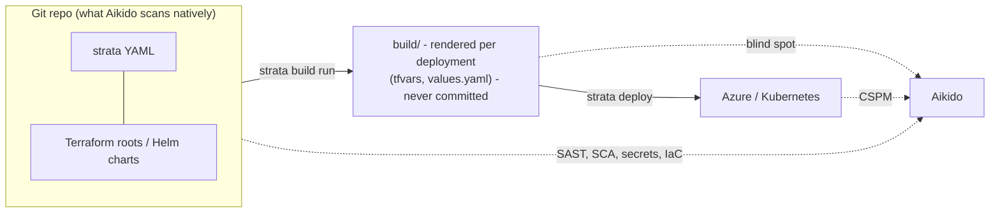

# Aikido Security - Work

- Status: in-progress (design accepted; Phases 1-6 of 7 done)
- Last updated: 2026-10-26

## Overview

The company is evaluating the [Aikido](https://www.aikido.dev) security platform. This doc tracks
what that means for strata: where Aikido covers ground strata already covers, where it can't see
what strata produces, and what strata or its consumers' pipelines should change.

A design is now proposed, **vendor-neutral**: two deploy gates (release gate, image gate) backed by
two integration capabilities (`release_gate`, `image_findings`), with Aikido as the first
implementation of both. Companion docs, written to be implemented offline:

- [security-gates-design.md](security-gates-design.md) - the design (decisions D1-D11,
  configuration, component design, diagnostic codes, risks).
- [security-gates-implementation-plan.md](security-gates-implementation-plan.md) - seven phases
  with files, tasks, tests and a definition of done.
- [aikido-api-reference.md](aikido-api-reference.md) - the offline Aikido API reference, test
  fixtures and strata code anchors (Appendices A-D). Its sections 1-13 are the first, Aikido-only
  design, superseded but kept for the vendor-specific reasoning the new design reuses.

This doc stays the index: status, how the earlier brainstorm was resolved, and what is still open.

Evidence levels used below:

- **Verified** - read directly from Aikido's own published source/README on GitHub (2026-10-26):
  [`AikidoSec/ci-api-client`](https://github.com/AikidoSec/ci-api-client) and
  [`AikidoSec/safe-chain`](https://github.com/AikidoSec/safe-chain).
- **Unverified** - from general knowledge of the product. Aikido's docs site
  (`help.aikido.dev`) and marketing pages could not be fetched for this draft; confirm before
  designing against any of it.

## Current Design / Progress

### What Aikido is (unverified)

A developer-focused application security platform (Ghent, Belgium) that bundles scanners behind
one dashboard with auto-triage: SCA (dependencies, licences, malware), SAST, secrets, IaC
(Terraform, CloudFormation, Kubernetes, Helm), container images, CSPM (live AWS/Azure/GCP
configuration), DAST/surface monitoring, and an in-app runtime firewall ("Zen"). Native
integrations with GitHub, GitLab, Bitbucket and Azure DevOps; IDE plugins; Jira/Slack.

### What strata already does (verified, this repo)

v2 already ships its own scanner-type integrations, so Aikido overlaps rather than fills a gap:

- **Checkov on rendered output** - runs in `build run` against the per-deployment rendered
  Terraform/Bicep/Ansible/Helm artifacts
  ([checkov-integration.md](../archive/checkov-integration.md), shipped).
- **CVE scanning** - Trivy/Grype over the CycloneDX SBOM, with a solution-wide allowlist
  ([cve-scanner-integration.md](../archive/cve-scanner-integration.md), shipped).
- **SBOM generation** - CycloneDX, Phase 1 collectors ([sbom-generation.md](sbom-generation.md)).

### The core tension: Aikido scans repositories, strata's risk is in build output



A Terraform root can be clean in the repo while one deployment's rendered tfvars open a firewall
rule to the world. Only strata's own Checkov step sees the rendered, per-deployment content today.
Aikido's CSPM sees the result after it is deployed, which is later than we want for a gate.

### Proposed design (summary)

Full detail in [security-gates-design.md](security-gates-design.md). In short:

- **Two capabilities, not a "platform" type** (D1): `release_gate` ("does repository X at commit Y
  pass?") and `image_findings` ("which open issues does image Z have?"), each with its own ABC in
  `integrations/capabilities.py` and neutral result types. `AikidoIntegration` implements both; a
  later vendor implements whichever it supports.
- **Two workspace policies, generic fields only** (D3): `release_gate_policy` and
  `image_gate_policy` next to `cve_policy` and `checkov_policy`, each naming its Integration
  document (like `output_store_integration`), with `enforcement: deny | warn` and
  `on_missing_data: skip | warn | block`. `strata validate` checks the named document has the
  capability. Vendor knobs (Aikido's `fail_on`, `minimum_severity`, image naming) live on the
  Integration document (D4).
- **Runs at deploy preflight**, after value resolution and before any provisioning step; never in
  `build run` (no network, no secrets there - ADR-0022 D4). `--smoke-test` makes no call;
  `--dry-run` does run the gates (D5).
- **Credentials are key references** resolved through `resolve_values()` (Key Vault, Infisical,
  GitHub secrets, environment), never in a document; the vendor class owns its env-var fallback (D2).
- **Recorded in `policy_results.json`** as `release_gate_policy` / `image_gate_policy`
  (`phase: deploy`, `policy_type` = the vendor); a breach exits 3 like CVE/Checkov (D9).
- **Commands named by function** (D7): a general `strata policy list | check | findings` group that
  every workspace policy can join (not `security`: a future OPA policy is mostly not about
  security), and `strata integration check <name>` (connection check, open to every integration).

Why a strata feature rather than only a pipeline step: the gates need the deployment's resolved
secrets (Key Vault) and its rendered `sbom.json`, must stop a deploy before any provisioner
runs, and should land in the same audit record as the other policies. `scan-release` as a plain
pipeline step remains possible for teams that don't want any of that.

### How the brainstorm options were resolved

| Brainstorm option                            | Outcome in the design                                                                                                                                                                                                    |
| -------------------------------------------- | ------------------------------------------------------------------------------------------------------------------------------------------------------------------------------------------------------------------------ |
| 1. Upload strata's Checkov results to Aikido | **Deferred (design D10).** Aikido's custom upload expects Checkov **SARIF** and, for SBOMs, **Syft JSON** with a container image name; strata writes neither today.                                                      |
| 2. `scan-release` as a pipeline gate         | **Adopted, inside strata**: the release gate reproduces `aikido-api-client scan-release` over HTTP, without Node (design D11, reference Appendix A.3).                                                                   |
| 3. CSPM as drift detection                   | Not in scope of the design; still a valid use of Aikido on its own.                                                                                                                                                      |
| 4. Fate of strata's own scanners             | **Kept.** The image gate complements Trivy/Grype (Aikido's triage, no scanners on runners); Checkov stays the only check on rendered output. Running `aikido-local-scanner` on rendered output is deferred (design D10). |

### Design checked against this repo (2026-10-26)

The design was written against the 2.0.0rc1 sdist. Every code anchor in its Appendix C was found
in this repo (21 of 21: integration base/registry/capabilities, `bind_integration_config`,
`policy_results`, `evaluate_cve_policy`/`_apply_allowlist`/`_report_missing_data`,
`_cve_policy_result`, `deploy_controller`'s `secret_values`/`_MIN_REDACT_LENGTH`/`smoke_test`,
`http_request`/`NO_RESPONSE`, `image_to_purl`, `ManifestPolicyResultModel`, `References`).
Paths that did not match the repo were corrected in the copies: test files follow
`tests/strata/<layer>/test_<layer>_<name>.py`, fixtures go in a new `tests/strata/fixtures/aikido/`,
the how-to goes in `docs/how-to/` (there is no `docs/guides/`), and `sbom-generation.md` is in
`docs/work/`.

Code docstrings cite `docs/work/security-gates-design.md`; when the feature is finished the design
graduates to `docs/design/security-gates.md`, and this index, the plan and the Aikido reference go
to `docs/archive/`.

### Brainstorm (2026-10-26, kept for context)

1. **Push strata's Checkov results into Aikido** (verified mechanism). The CI client supports
   `aikido-api-client upload --repository-id <id> --type checkov --file <payload>`. Strata keeps
   scanning rendered output per deployment; findings appear in Aikido's dashboard next to
   everything else. Likely a pipeline step, possibly zero strata code if strata's existing Checkov
   output is already in the expected format. The README notes upload is supported by the `scan`
   command only.
2. **Release gate as a pipeline step** (verified mechanism).
   `aikido-api-client scan-release <repo> <commit>` exits `0` (gate passed), `10` (gate failed)
   or `1` (error); flags include `--fail-on-iac-scan`, `--fail-on-sast-scan`,
   `--fail-on-secrets-scan`, `--minimum-severity-level LOW|MEDIUM|HIGH|CRITICAL`, `--sla-mode`
   and `--json`. Runs before `strata deploy apply`; no strata feature needed.
3. **CSPM as drift detection** (unverified). v2 has no drift detection. Aikido watching the live
   Azure configuration catches what was really deployed, including manual changes.
   Complementary, not overlapping.
4. **Decide the fate of strata's own scanners.**
   - (a) Keep Checkov + CVE in strata as the offline gate on rendered output; feed results to
     Aikido (option 1).
   - (b) Retire them; accept the rendered-output blind spot.
   - (c) Keep Checkov (only it sees rendered output); retire CVE/SBOM scanning if Aikido's
     container and dependency scanning covers the same images.

   Leaning (c), pending the comparison in Phase 1 below.

### Gotchas found (verified, Safe Chain)

Safe Chain wraps `pip`/`pip3`/`uv`/`uvx`/`pipx`/`poetry`/`pdm` (and the npm family) on laptops and
in CI (Azure Pipelines and GitHub Actions examples published), blocking known-malicious packages.

- **48-hour minimum package age.** By default it suppresses releases younger than 48 hours from
  the resolver's metadata. Effect on strata consumers right after a release:
  an *unpinned* `pip install xyz-strata` silently resolves to the **previous** version; a
  *pinned* install of the new version fails. Fix: exclude strata in the repo's `.aikido` file:

  ```yaml
  safe-chain:
    pip:
      minimumPackageAgeExclusions:
        - xyz-strata
  ```

- **Private feeds.** Our private Python feed must be listed under `customRegistries`
  (`SAFE_CHAIN_PIP_CUSTOM_REGISTRIES` or `.aikido`). If pip relies on a `pip.conf`,
  `PIP_CONFIG_FILE` must point at it or Safe Chain's temporary config overrides it. Interaction
  with uv's `--index-strategy unsafe-best-match` (which this repo already needs) is untested.

Candidates for the scaffolded `project-gotchas` agent skill once confirmed in a real pipeline.

## Related Decisions

- [ADR-0046](../decisions/0046-strata-agent-skills-with-generated-marker.md) - scaffolded agent
  skills; the `project-gotchas` skill is where confirmed Aikido/Safe Chain lessons would go.
- [policy-engine-architecture.md](policy-engine-architecture.md) - Checkov and CVE scanning are
  its "bucket C" (real external scanner) concerns; any change here belongs in that framing.

## Remaining Work / Open Questions

Implementation phases (detail in
[security-gates-implementation-plan.md](security-gates-implementation-plan.md)):

- [x] **Phase 1** - neutral types, `release_gate`/`image_findings` capabilities and ABCs, credential
      and connection-check mixins. Done 2026-10-26.
- [x] **Phase 2** - `release_gate_policy` / `image_gate_policy` models, workspace fields, capability
      semantic check. Done 2026-10-26.
- [x] **Phase 3** - `AikidoIntegration`: configuration, transport, release gate (CI API). Done 2026-10-26.
- [x] **Phase 4** - `AikidoIntegration`: image findings (OAuth, containers, issues), connection check.
      Done 2026-10-26.
- [x] **Phase 5** - `security_gate_controller`, deploy preflight hook, `append_policy_result`. Done 2026-10-26.
- [x] **Phase 6** - `strata policy list | check | findings` (gates only), `strata integration check`,
      user docs, agent skill command table. Done 2026-10-26.
- [ ] **Phase 7** - first contact with a real Aikido workspace; resolves every [U] in the Aikido
      reference.
- [ ] **Phase 8** - follow-on: `cve_policy` joins `strata policy check` / `findings`.
- [ ] **Phase 9** - follow-on: `checkov_policy` joins them (design first: a standalone check needs the
      rendered source paths `build run` only holds in memory).
- [ ] **Phase 10** - follow-on: a future `opa_policy` (design first, only on real consumer demand).
- [ ] Record the decision as an ADR once the design is accepted.

Still open, outside the design:

- **Integration readiness** (local tool/version checks next to `integration check`'s connection
  check, and the unenforced `spec.version`): tracked separately in
  [integration-readiness.md](integration-readiness.md).
- **Evidence check:** compare, for one real deployment (haven `prd`), Aikido's repo scan with
  strata's Checkov on the rendered `build/` output. Not needed to build the gates, but it decides
  whether the deferred upload/local-scanner work (D12) is worth doing.
- **Safe Chain** in consumer pipelines: the 48-hour package-age exclusion for `xyz-strata` and the
  private-feed `customRegistries` (see Gotchas above). Not a strata change; a recipe for haven and
  cfg-int, and a candidate for the `project-gotchas` skill.
- **Azure DevOps** (cfg-int) vs GitHub (haven): commit SHA resolution covers both
  (`BUILD_SOURCEVERSION`, `GITHUB_SHA`), but repository registration in Aikido is unconfirmed.
- **Device Protection** may flag or block a sideloaded strata `.vsix` or the scaffolded
  `.claude/skills/`.
- **Pricing tier** for the CI API and REST API, and data residency (EU host is the default).
- **Release timing:** the design targets strata 2.x after 2.0.0; schedule against the RC trial.

## Changelog

- 2026-10-26: Code review fixes: `integration check` no longer accepts a CI token on 429/5xx;
  unresolved credential errors carry the value pipeline's reason; the image gate no longer reports
  "passed" next to an image error (`image_gate_counted`); an unreadable `policy_results.json` is a
  clean error; `integration check` refuses a disabled integration. Full suite green (3368 passed).
- 2026-10-26: Phase 6 built: `controllers/policy_controller.py` (the dispatch table),
  `list_image_findings()`, `strata policy list | check | findings`, `strata integration check`, the
  how-to `docs/how-to/security-gates.md`, config doc and agent skill updates. Everything a pipeline
  needs now works offline; Phase 7 (a real Aikido workspace) is next. Full suite green (3358 passed).
- 2026-10-26: Commands redesigned before Phase 6: `strata security gate | findings` became a
  general `strata policy list | check | findings` group (design D7). "Policy" is already strata's
  shared concept (the `*_policy` workspace fields, `policy_results.json`), and `security` would not
  fit a future OPA policy. A small dispatch table, not a policy engine, keeps
  policy-engine-architecture.md's "bespoke" decision. Scope kept small: `check` covers the two gates,
  `findings` the image gate; `cve_policy`, `checkov_policy` and a future `opa_policy` each get their
  own follow-on phase (8-10) in the plan.
- 2026-10-26: Phase 5 built: `controllers/security_gate_controller.py` (credentials via
  `AuthenticationModel`, commit SHA resolution, SBOM images, thresholds, allowlist,
  `on_missing_data`/`on_unknown_image`), `append_policy_result()`, and the `deploy run` preflight
  hook. Gates are now enforced at deploy. Full suite green (3303 passed).
- 2026-10-26: Phase 4 built: Aikido image findings over the REST API (OAuth client credentials,
  container lookup and naming, open-issue export), `check_connection()`, and `aikido` registered, so
  `type: aikido` documents now pass the validate capability checks. Full suite green (3249 passed).
- 2026-10-26: Phase 3 built: `integrations/aikido.py` with configuration and authentication
  validation (`integration_configuration_invalid`), region/host resolution, retries, and the release
  gate over Aikido's CI API (start, poll, outcome; `GateNotFoundError`/`GateTimeoutError`). Not
  registered until Phase 4 completes image findings. Full suite green (3214 passed).
- 2026-10-26: Phase 2 built: `models/security_gate_model.py` (`ReleaseGatePolicyModel`,
  `ImageGatePolicyModel`), `WorkspaceSpecModel.release_gate_policy`/`image_gate_policy`, and the
  validate check `_check_workspace_security_gates()` (`gate_integration_capability_missing`,
  `gate_integration_type_unsupported`). Full suite green (3155 passed).
- 2026-10-26: Phase 1 built: `Capability.RELEASE_GATE`/`IMAGE_FINDINGS`, the
  `ReleaseGateIntegration`/`ImageFindingsIntegration` ABCs (registered in `CAPABILITY_ABCS`),
  `CredentialedIntegration`/`ConnectionCheckIntegration` mixins, `integrations/security_findings.py`,
  `GateNotFoundError`/`GateTimeoutError`, `AuthenticationModel.key_references()`,
  `sbom_utils.split_registry()`. Full suite green (3124 passed).
- 2026-10-26: Design review applied and plan rewritten to match. Review fixes: one uppercase
  severity vocabulary with `UNKNOWN` (as `cve_policy`/Checkov), gate exceptions in
  `integrations/errors.py`, `ImageRef` with `tag`/`digest` plus a `utils` `split_registry()` helper,
  and a validate check following both existing precedents (document declares the capability; class
  implements its ABC). Credentials now use `AuthenticationModel` (no new mechanism): one Integration
  document per credential (`aikido-ci`: `api_key` -> `release_gate`; `aikido-api`: `oauth2` ->
  `image_findings`), keys from a new `AuthenticationModel.key_references()`, resolved like remote
  credentials.
- 2026-10-26: Generalized the design. Instead of an `aikido` command, policy and diagnostic codes,
  strata gets two vendor-neutral capabilities (`release_gate`, `image_findings`), two workspace
  policies (`release_gate_policy`, `image_gate_policy`), `strata security gate | findings` and
  `strata integration check`, with Aikido as the first implementation. Reason: every strata command
  is named by function with vendors behind it (`values`, `deploy`, `audit`), and renaming a CLI
  command later breaks consumer pipelines. New
  [security-gates-design.md](security-gates-design.md) and
  [security-gates-implementation-plan.md](security-gates-implementation-plan.md); the Aikido-only
  design became [aikido-api-reference.md](aikido-api-reference.md) (appendices authoritative,
  sections 1-13 superseded); the Aikido-only plan was removed (superseded entirely).
- 2026-10-26: Added the proposed (Aikido-only) design and implementation plan as
  `aikido-integration-design.md` and `aikido-implementation-plan.md` (copied in, then corrected to
  this repo's test and docs layout). Recorded the design summary, how each brainstorm option was
  resolved, the anchor check, and the plan's phases; status is now design proposed.
- 2026-10-26: Created from an initial brainstorm. Corrected an early assumption that v2 had not
  ported v1's Checkov/CVE scanners (both shipped; see the archive docs).
